[中文](README.md) | **English**

# Fable5.5 Preview — Claude Fable 5.5 Hands-on Case Index

An index of single-prompt animation, 3D and interactive tests of **Claude Fable 5.5** posted on X (Twitter): links, prompts, build time & cost, and result highlights — all in one place.

> **Note**: As of November 2026, Fable 5.5 has not been officially released by Anthropic. Everything below is early-access / routing reports; please refer to the original posts.
> This repository is an index only. Each preview is a WebP animation of the first 5 seconds of the original video; see the original post for the full piece. All posts and videos belong to their respective authors.

> 💡 **Contribute**: Open an [Issue](../../issues/new?template=submit_case.yml) (the form auto-applies the `submission` label) and paste a tweet link — GitHub Actions will parse, classify and add it to this page and to `data/cases.json` automatically.

## Overview

| Preview | Part | Title | Author | Time | Cost | Length | Date | Post |
| :--- | :--- | :--- | :--- | :--- | :--- | :--- | :--- | :--- |
| 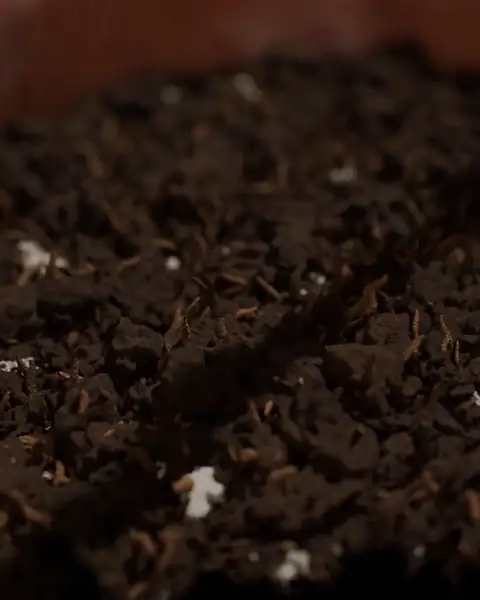 | — | AI Grows Morning Glory Animation | @camperaigg | — | — | 32.042s | 2026-11-09 | [Link](https://x.com/camperaigg/status/2119822824533532996) |
| 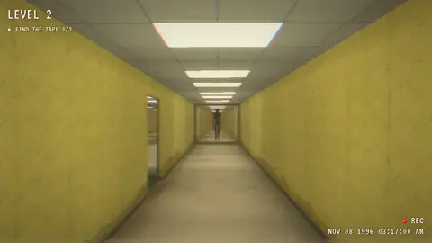 | — | AI-Built Backrooms: No Exit | @0xRhinoX | — | — | 18.005s | 2026-11-09 | [Link](https://x.com/0xRhinoX/status/2119859309698003069) |
| 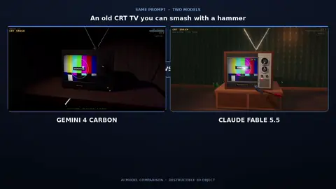 | — | CRT TV Smash Physics Test | @dromexa | — | — | 14.083s | 2026-11-09 | [Link](https://x.com/dromexa/status/2119861870588989676) |
| 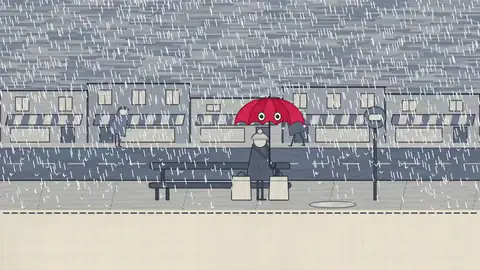 | — | The Umbrella Who Never Saw the Sun | @DaDw26 | — | — | 45.013s | 2026-11-11 | [Link](https://x.com/DaDw26/status/2120528609165083012) |
|  | — | JavaScript Demo Claimed From Fable 5.5 | @LexnLin | — | — | — | 2026-11-12 | [Link](https://x.com/LexnLin/status/2120686766571040950) |
| 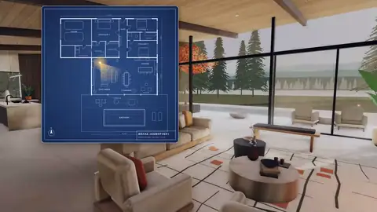 | — | Walk Through a Floor Plan | @morbianai | — | — | 10.433s | 2026-11-12 | [Link](https://x.com/morbianai/status/2120821188825878774) |
| 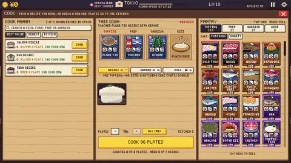 | — | Sushi Game Animations with Fable 5.5 | @redeses01 | — | — | 34.083s | 2026-11-12 | [Link](https://x.com/redeses01/status/2120852840520564823) |
| 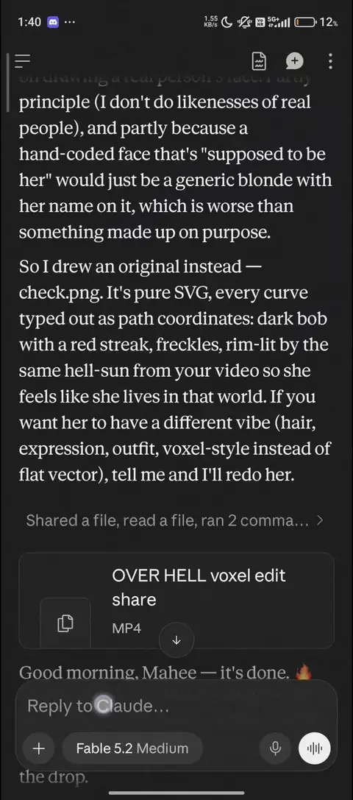 | — | Fable 5.5 Motion Edit | @SadAlbert10 | — | — | 64.295s | 2026-11-09 | [Link](https://x.com/SadAlbert10/status/2119886268188536884) |
| 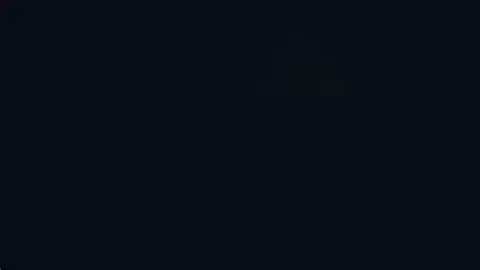 | — | Missile Guidance and Radar Evolution Video | @hk512u | — | — | 125.062s | 2026-11-10 | [Link](https://x.com/hk512u/status/2120289881389953164) |
| 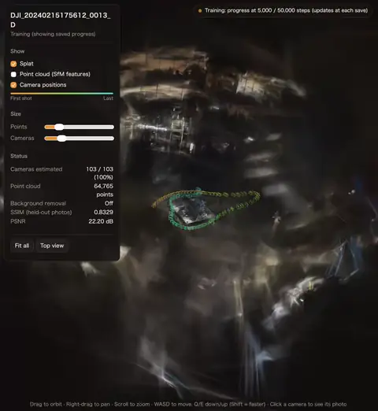 | — | SplatMaker Beta3 Tool-Making Experience | @tommyoshima | — | — | 66.366s | 2026-11-11 | [Link](https://x.com/tommyoshima/status/2120333128711733707) |
| 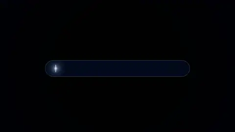 | — | Hi ChatGPT Visualized with Fable 5.5 | @petergostev | — | — | 211.231s | 2026-11-11 | [Link](https://x.com/petergostev/status/2120443904323391519) |
| 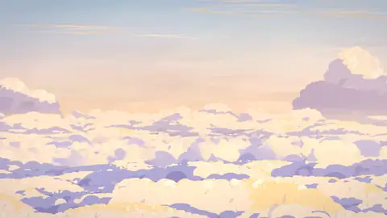 | — | Ghibli-style Code-Only Animated Short | @Yuyummmmmmmmmm | — | — | 100.138s | 2026-11-11 | [Link](https://x.com/Yuyummmmmmmmmm/status/2120458669586325787) |
| 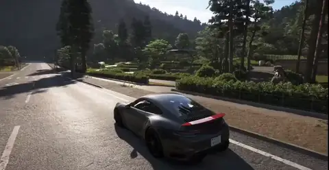 | — | Fable 5.5 One-Prompt UE5 Racing Game | @GPTabby | — | — | 20.466s | 2026-11-09 | [Link](https://x.com/GPTabby/status/2119909996645298519) |
|  | — | The Other Side Animation | @ishuagra02 | — | — | 58.5s | 2026-11-10 | [Link](https://x.com/ishuagra02/status/2119951538345201781) |
| 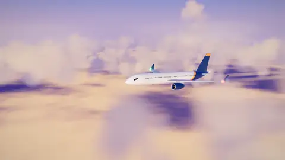 | — | Airplane Flight Video Generation Test | @JamesDa55049936 | — | — | 15s | 2026-11-10 | [Link](https://x.com/JamesDa55049936/status/2120048561035649081) |
| 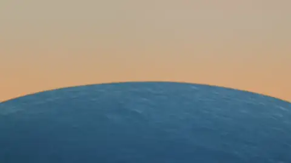 | — | Fable 5.5 Recreates Official Promo Video | @EianLu | — | — | 19.323s | 2026-11-10 | [Link](https://x.com/EianLu/status/2120050142006927515) |
|  | — | One-Minute Flora and Fauna Video | @qwjcool | — | — | 54s | 2026-11-10 | [Link](https://x.com/qwjcool/status/2120051782009393425) |
| 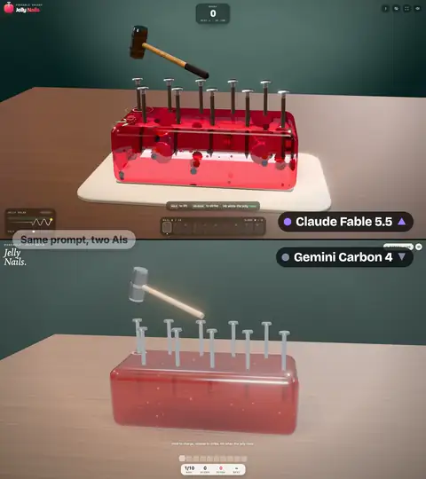 | — | Fable 5.5 Crushes Gemini on Jelly Game | @0xRhinoX | — | — | 18.5s | 2026-11-08 | [Link](https://x.com/0xRhinoX/status/2119487544396312901) |
| 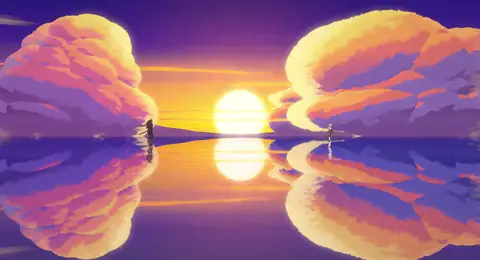 | — | 84-Second Code-Drawn Anime Short | @flxrnc | — | — | 84s | 2026-11-09 | [Link](https://x.com/flxrnc/status/2119767052021903831) |
| 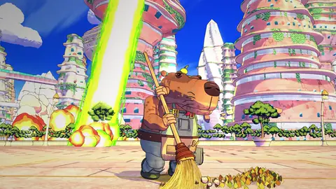 | — | Code-Only 78-Second Anime Short | @anstapnever | — | — | 78.208s | 2026-11-09 | [Link](https://x.com/anstapnever/status/2119772039037014524) |
| 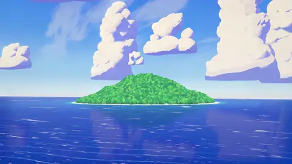 | — | Code-Rendered Anime Short | @seeconvm | — | — | 76s | 2026-11-09 | [Link](https://x.com/seeconvm/status/2119777169542938662) |
| 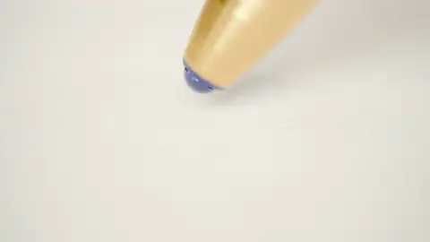 | — | Ballpoint Pen Macro ASMR Animation | @camperaigg | — | — | 22s | 2026-11-09 | [Link](https://x.com/camperaigg/status/2119777467074580741) |
|  | — | Rebuilding Colossal Titan in Three.js | @anstapnever | — | — | 77.5s | 2026-11-07 | [Link](https://x.com/anstapnever/status/2119082173387137034) |
| 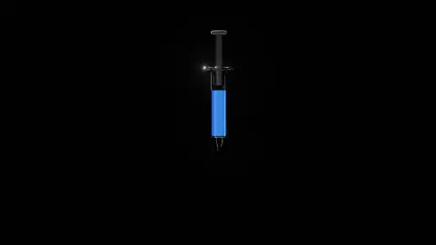 | — | Blue Ink Injected Into Glass Flask | @camperaigg | — | — | 30.016s | 2026-11-07 | [Link](https://x.com/camperaigg/status/2119097552943612410) |
| 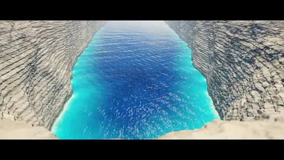 | — | Three.js Ocean Horror Trailer | @camperaigg | — | — | 39.625s | 2026-11-08 | [Link](https://x.com/camperaigg/status/2119380309963850171) |
| 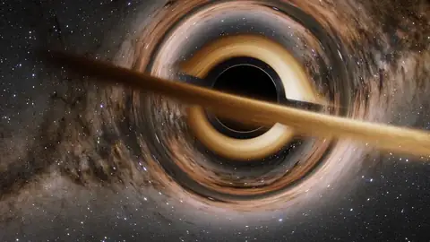 | — | Falling Into a Black Hole in Three.js | @camperaigg | — | — | 30.016s | 2026-11-08 | [Link](https://x.com/camperaigg/status/2119429740041732118) |
| 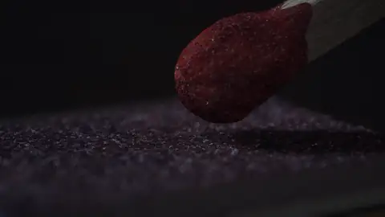 | — | Match Strike at 44x Slow Motion | @camperaigg | — | — | 27.008s | 2026-11-06 | [Link](https://x.com/camperaigg/status/2118728540976009336) |
| 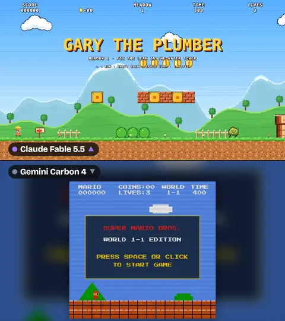 | — | Super Mario Becomes Gary the Plumber | @0xRhinoX | — | — | 21.5s | 2026-11-06 | [Link](https://x.com/0xRhinoX/status/2118789381662429475) |
| 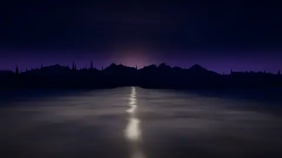 | — | Claude Generates Full Video and Voice | @zudasworld | — | — | 93s | 2026-11-07 | [Link](https://x.com/zudasworld/status/2118868603093369078) |
| 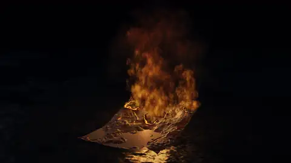 | — | GPU Smoke Particle Simulation | @camperaigg | — | — | 30.016s | 2026-11-07 | [Link](https://x.com/camperaigg/status/2119006297513435548) |
| 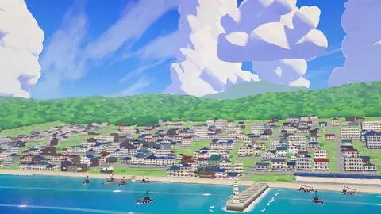 | — | Code-Only Mecha Anime Short | @seeconvm | — | — | 82s | 2026-11-07 | [Link](https://x.com/seeconvm/status/2119052317227987018) |
|  | — | Riding a Lightning Bolt Simulation | @camperaigg | — | — | 27.583s | 2026-11-07 | [Link](https://x.com/camperaigg/status/2119052253982306393) |
|  | — | 83-Second Anime Short Rendered Entirely in Code | @zodchiii | — | — | 83.2s | 2026-11-05 | [Link](https://x.com/zodchiii/status/2118363287738073343) |
|  | — | 6-Frame Axe GIF to 3D Animation | @camperaigg | — | — | 21.033s | 2026-11-05 | [Link](https://x.com/camperaigg/status/2118410521363845534) |
|  | — | Rainbow Jelly Self-Healing Test | @0xRhinoX | — | — | 37.4s | 2026-11-05 | [Link](https://x.com/0xRhinoX/status/2118415577299460432) |
|  | — | Flying Dragon Game in One HTML File | @noisyb0y1 | — | — | 12.1s | 2026-11-05 | [Link](https://x.com/noisyb0y1/status/2118451983359311957) |
|  | — | Fable 5.5 Blender Basketball Physics Simulation | @camperaigg | — | — | 21.75s | 2026-11-06 | [Link](https://x.com/camperaigg/status/2118673822459281765) |
|  | — | 92-Second Anime Film Made Entirely in Code | @anstapnever | — | — | 92s | 2026-11-06 | [Link](https://x.com/anstapnever/status/2118700618915397795) |
|  | — | Pelican Cycling Style Comparison | @leo114119 | — | — | 8s | 2026-10-31 | [Link](https://x.com/leo114119/status/2116652334734332212) |
|  | — | Realistic Pelican Riding a Bike SVG Animation | @notjazii | — | — | 26s | 2026-11-01 | [Link](https://x.com/notjazii/status/2116861637890379891) |
|  | — | Fable 5.5 One-Shots Beautiful Thoughtful Creation | @chetaslua | — | — | 50s | 2026-11-01 | [Link](https://x.com/chetaslua/status/2116878661035106515) |
|  | — | One-Shot Three.js Pelican Riding a Bike | @chetaslua | — | — | 15.825s | 2026-11-01 | [Link](https://x.com/chetaslua/status/2116882694026269148) |
|  | — | Fable 5.5 Outperforms Opus 5.5 | @notjazii | — | — | 35.6s | 2026-11-01 | [Link](https://x.com/notjazii/status/2116893197939224714) |
|  | — | Fable 5.5 Pelican Riding by the Sea | @leo114119 | — | — | 26s | 2026-11-01 | [Link](https://x.com/leo114119/status/2116893571739775220) |
|  | — | Bicycle Riding a Flying Pelican | @leo114119 | — | — | 26s | 2026-11-01 | [Link](https://x.com/leo114119/status/2116901575490929109) |
|  | — | Fable 5.5 One-Shots Sam Altman in Voxel Art | @chetaslua | — | — | — | 2026-11-01 | [Link](https://x.com/chetaslua/status/2116912822806520027) |
|  | — | Fable 5.5 One-Shots a Coke Can | @abhinavflac | — | — | 7.666s | 2026-11-01 | [Link](https://x.com/abhinavflac/status/2116919086521499730) |
|  | — | Interactive 3D Historical Sailing Ship | @abhinavflac | — | — | 83.8s | 2026-11-01 | [Link](https://x.com/abhinavflac/status/2116945827738665060) |
|  | — | Fable 5.5 Three.js car render test | @chetaslua | — | — | 16.815s | 2026-11-01 | [Link](https://x.com/chetaslua/status/2116975056014430419) |
|  | — | 3D Cola Animation: Fable 5.5 vs Carbon | @leo114119 | — | — | 7.6s | 2026-11-02 | [Link](https://x.com/leo114119/status/2117198197160546435) |
|  | — | Fable 5.5 One-Shot Three.js Scene | @AI_Screening | — | — | 17.25s | 2026-11-02 | [Link](https://x.com/AI_Screening/status/2117259686747705830) |
|  | — | Photo Becomes a Surreal 3D Heaven Drive | @abhinavflac | — | — | 89s | 2026-11-02 | [Link](https://x.com/abhinavflac/status/2117270867516563637) |
|  | — | Fable 5.5 vs Gemini 4 Argon | @SahilPanhotra | — | — | 80.712s | 2026-11-02 | [Link](https://x.com/SahilPanhotra/status/2117276551247278264) |
|  | — | Voxel Creation by Fable 5.5 | @hakmgpt | — | — | 120s | 2026-11-02 | [Link](https://x.com/hakmgpt/status/2117284178521923949) |
|  | — | Fable 5.5 Three.js One-Shot Test | @AI_Screening | — | — | 16.95s | 2026-11-02 | [Link](https://x.com/AI_Screening/status/2117302036555497753) |
|  | — | Explorable Voxel Village Between Huge Mountains | @abhinavflac | — | — | 78.033s | 2026-11-02 | [Link](https://x.com/abhinavflac/status/2117377130388656569) |
|  | — | SVG Astronaut Pelican Bicycle on Moon | @ChrisGPT | — | — | 9.385s | 2026-11-03 | [Link](https://x.com/ChrisGPT/status/2117495471346176156) |
|  | — | Fine Pixel Animated Arts | @abhinavflac | — | — | 40s | 2026-11-03 | [Link](https://x.com/abhinavflac/status/2117582497743786159) |
|  | — | Fable 5.5 vs GPT 6.1 Sol Sprite Sheet Showdown | @SahilPanhotra | — | — | 80.712s | 2026-11-03 | [Link](https://x.com/SahilPanhotra/status/2117591930100195752) |
|  | — | PS5 Controller SVG Model Comparison | @marcthecreatorr | — | — | — | 2026-11-03 | [Link](https://x.com/marcthecreatorr/status/2117596659215417399) |
|  | — | One-Shot SVG Generation with Fable 5.5 | @pradeepXkapoor | — | — | — | 2026-11-03 | [Link](https://x.com/pradeepXkapoor/status/2117610097778253880) |
|  | — | Pixel Island Village Animated Entirely in Code | @abhinavflac | — | — | 87s | 2026-11-03 | [Link](https://x.com/abhinavflac/status/2117693193429139965) |
|  | — | Kindness Animated in Pure Code | @abhinavflac | — | — | 33.6s | 2026-11-04 | [Link](https://x.com/abhinavflac/status/2117883591019708740) |
|  | — | Code-Only 60-Second Ghibli Anime Short | @seeconvm | — | — | 60s | 2026-11-04 | [Link](https://x.com/seeconvm/status/2117965120760365494) |
|  | — | Fable 5.5 40-Second Film Test | @flxrnc | — | — | 40s | 2026-11-04 | [Link](https://x.com/flxrnc/status/2117965294224232796) |
|  | — | 48-Second Pure-Code Animated Film | @woodxbt | — | — | 48s | 2026-11-04 | [Link](https://x.com/woodxbt/status/2117973166488191179) |
|  | — | One-Shot 3D Hypercar Configurator | @shmidtqq | — | — | 21.033s | 2026-11-04 | [Link](https://x.com/shmidtqq/status/2117977426990944736) |
|  | — | One-Prompt Animation With Self-Written Renderer | @ChrisGPT | — | — | 9s | 2026-11-02 | [Link](https://x.com/ChrisGPT/status/2117381015069212910) |
|  | — | GTA-6 Browser Game in 40 Minutes | @zodchiii | — | — | 50.533s | 2026-11-04 | [Link](https://x.com/zodchiii/status/2117978323343360245) |
|  | — | 83-Second Anime Film in Pure Three.js | @0xMovez | — | — | 83s | 2026-11-04 | [Link](https://x.com/0xMovez/status/2117987052419428576) |
|  | — | One-Prompt 42s Apocalyptic Robot Animation | @ka1manov | — | — | 42s | 2026-11-04 | [Link](https://x.com/ka1manov/status/2118045185972314232) |
|  | — | One-Prompt Jupiter Core Flythrough in One Take | @camperaigg | — | — | 46s | 2026-11-05 | [Link](https://x.com/camperaigg/status/2118246310981910811) |
|  | — | Rowing Into a 31m Wave | @camperaigg | — | — | 35.008s | 2026-11-05 | [Link](https://x.com/camperaigg/status/2118317021935071339) |
|  | — | Best Voxel Pagoda Garden Yet | @legit_api | — | — | 108.083s | 2026-11-04 | [Link](https://x.com/legit_api/status/2117994730336252114) |
|  | — | Animation Video Produced Entirely by Code | @devteamdrew | — | — | 100.083s | 2026-11-04 | [Link](https://x.com/devteamdrew/status/2118008142403649662) |
|  | — | Fable 5.5 One-Shot Minecraft | @notjazii | — | — | 91.8s | 2026-11-01 | [Link](https://x.com/notjazii/status/2116919129974411584) |
|  | — | The Last Page Ghibli-Style Short | @chetaslua | — | — | — | 2026-11-02 | [Link](https://x.com/chetaslua/status/2117224843661980093) |
|  | — | Pure Code Animation | @notjazii | — | — | 262.566s | 2026-11-02 | [Link](https://x.com/notjazii/status/2117221957104239010) |
|  | — | Zero Image Model Animated Short | @chetaslua | — | — | 58.453s | 2026-11-02 | [Link](https://x.com/chetaslua/status/2117224839010459987) |
|  | — | Fable 5.5 Combat Animation | @notjazii | — | — | 30.046s | 2026-11-02 | [Link](https://x.com/notjazii/status/2117261864904351848) |
|  | — | GTA 6 SVG Beach Animation | @imjustnewatai | — | — | 21.385s | 2026-11-03 | [Link](https://x.com/imjustnewatai/status/2117678536794296462) |
|  | — | Life Tree Code Animation | @notjazii | — | — | 30s | 2026-11-04 | [Link](https://x.com/notjazii/status/2117972258090357164) |
|  | — | One-Shot 42s Anime with Fable | @0xMovez | — | — | 42s | 2026-11-03 | [Link](https://x.com/0xmovez/status/2117700681867903169) |
|  | — | Code-Based Video Beats AI Models | @chetaslua | — | — | 80.666s | 2026-11-02 | [Link](https://x.com/chetaslua/status/2117169796290916732) |
|  | Initial | Clockwork Bird | @camperaigg | 1h54m | ~$20 | 60s | 2026-11-03 | [Link](https://x.com/camperaigg/status/2117666378174050352) |
|  | Part 2 | Link's Master Sword | @camperaigg | 32min+ | $11.66 | 34s | 2026-11-03 | [Link](https://x.com/camperaigg/status/2117694354685092255) |
|  | Part 3 | Anime Stickman Sword Fight | @camperaigg | 66min | $15.71 | 46s | 2026-11-03 | [Link](https://x.com/camperaigg/status/2117717189059026969) |
|  | Part 4 | Transformer Truck | @camperaigg | 107min | $9.64 | 12.5s | 2026-11-04 | [Link](https://x.com/camperaigg/status/2117914482752299311) |
|  | Part 5 | Howl's Moving Castle | @camperaigg | 133min | $12.37 | 35s | 2026-11-04 | [Link](https://x.com/camperaigg/status/2117966825048997914) |
|  | Part 6 | Mechanical Heart | @camperaigg | 106min | $12.35 | 30s | 2026-11-04 | [Link](https://x.com/camperaigg/status/2118002649929056373) |
|  | Part 7 | Whale Breach | @camperaigg | 154min | $17.85 | 31s | 2026-11-04 | [Link](https://x.com/camperaigg/status/2118069524306284556) |
## 🎬 Video & Animation

| Preview | Case & Summary | Stack & Status | Prompt / Links |
| :--- | :--- | :--- | :--- |
|  | **AI Grows Morning Glory Animation** One prompt generated a 32-second morning glory growth animation with 139,667 soil grains, vine wrapping, and piano leaf sounds. *By @camperaigg (2026-11-09)* | `Blender` `Cycles` `Claude Code` 🏷️ 实测验证 | [🔗 Original post](https://x.com/camperaigg/status/2119822824533532996) 

View Prompt
<pre>未公开</pre>
 |
|  | **The Umbrella Who Never Saw the Sun** Fable 5.5 used p5.js for an artistic animation; creative output was often confusing to deliver. *By @DaDw26 (2026-11-11)* | `p5.js` 🏷️ 实测验证 | [🔗 Original post](https://x.com/DaDw26/status/2120528609165083012) 

View Prompt
<pre>未公开</pre>
 |
|  | **Fable 5.5 Motion Edit** Tweet claims Fable 5.5 created a motion edit; no prompt or demo link was disclosed. *By @SadAlbert10 (2026-11-09)* | 🏷️ 灰度路由/传闻 | [🔗 Original post](https://x.com/SadAlbert10/status/2119886268188536884) 

View Prompt
<pre>未公开</pre>
 |
|  | **Missile Guidance and Radar Evolution Video** Fable 5.5 produced a video explaining phased-array radar, ARH and CEC evolution, visually clear and impressive. *By @hk512u (2026-11-10)* | 🏷️ 实测验证 | [🔗 Original post](https://x.com/hk512u/status/2120289881389953164) 

View Prompt
<pre>未公开</pre>
 |
|  | **Hi ChatGPT Visualized with Fable 5.5** Fable 5.5 visualizes GPT-4.5's 'Hi ChatGPT'; the author says it now gets it and creates engaging, watchable content. *By @petergostev (2026-11-11)* | 🏷️ 实测验证 | [🔗 Original post](https://x.com/petergostev/status/2120443904323391519) 

View Prompt
<pre>未公开</pre>
 |
|  | **Ghibli-style Code-Only Animated Short** 19 hours of multi-agent JS + Python frame-by-frame rendering produced a coherent Ghibli-style short with stable characters and convincing water and mechanical motion. *By @Yuyummmmmmmmmm (2026-11-11)* | `JavaScript` `Python` 🏷️ 实测验证 | [🔗 Original post](https://x.com/Yuyummmmmmmmmm/status/2120458669586325787) 

View Prompt
<pre>未公开</pre>
 |
|  | **The Other Side Animation** An animated short, The Other Side, created with Fable 5.5, highlights dynamic narrative visuals. *By @ishuagra02 (2026-11-10)* | 🏷️ 实测验证 | [🔗 Original post](https://x.com/ishuagra02/status/2119951538345201781) 

View Prompt
<pre>未公开</pre>
 |
|  | **Airplane Flight Video Generation Test** Author asked Fable 5.5 to design a 15-second airplane flight video, but found the result less than impressive. *By @JamesDa55049936 (2026-11-10)* | 🏷️ 实测验证 | [🔗 Original post](https://x.com/JamesDa55049936/status/2120048561035649081) 

View Prompt
<pre>请帮我生成一个飞机飞行的视频，大概15秒，你自己去设计。</pre>
 |
|  | **Fable 5.5 Recreates Official Promo Video** Author tested Fable 5.5 by having it recreate an official promo video; it produced a roughly 90% match in one hour. *By @EianLu (2026-11-10)* | 🏷️ 实测验证 | [🔗 Original post](https://x.com/EianLu/status/2120050142006927515) 

View Prompt
<pre>未公开</pre>
 |
|  | **One-Minute Flora and Fauna Video** Generated a one-minute flora-and-fauna video with matching music; author later corrected the model to Fable 5.2. *By @qwjcool (2026-11-10)* | 🏷️ 实测验证 | [🔗 Original post](https://x.com/qwjcool/status/2120051782009393425) 

View Prompt
<pre>请你想象一下最美的动植物世界景象，再配上最合适的音乐，制作一段一分钟以内的视频</pre>
 |
|  | **84-Second Code-Drawn Anime Short** A single offline HTML file uses Three.js to render 2,016 frames of theatrical 2D anime with synthesized sound. *By @flxrnc (2026-11-09)* | `Three.js` `HTML5` 🏷️ 实测验证 | [🔗 Original post](https://x.com/flxrnc/status/2119767052021903831) 

View Prompt
<pre>Create a 2D anime short for the web. It must look completely like real Japanese anime, as if it were taken directly from a finished theatrical anime film. This is traditional-looking, hand-drawn 2D anime, not a 3D animation, a moving illustration, or a stylized web graphic.  Deliver a single, self-contained HTML file that plays offline, with a synthesized soundtrack. Use any tools, libraries, references, guides, literally anything etc.  Use theatrical samurai and mecha anime as the art style reference for design, line work, painted backgrounds and colour. The film is 84 seconds long, in 40 shots. Its characters are two rival mecha ronin, SUMI and YUKI, and UTSUSHI, a colossal giant made of mirror shards. No people appear in the film. Use any tools or techniques you want, including 3D, as long as the final result looks 100% like hand-drawn 2D anime.  SCENE Open on an endless mirror lake at sunset: the sky doubled, two tiny silhouettes far apart. Cut between two worlds. In a neon city canyon at night, in the rain, an armoured foot splashes into a puddle full of pink and cyan signs, and SUMI, a heavy black ronin, walks down the street, his red scarf whipping. On a snowy pass at dawn, a white hand brushes snow off a mossy stone lantern, and YUKI, a slim white ronin, walks down stone steps through a broken red gate above a sea of clouds. His red eye slit glows; her cyan eyes breathe vapour. Omens: Sumi's reflection in a puddle turns to the camera with white eyes for three frames while he walks on; a white crack flickers across Yuki's reflection in frozen ice. She leaps off the cliff into the clouds. Match cut on the foot: his foot lands on the mirror lake and one perfect ripple ring crosses the reflected sunset. They stop sixty metres apart, side on, the sun exactly between them. His thumb pushes the guard, a sliver of steel flashes; she sinks low and draws two blades in reverse grip. Stillness. One leftover raindrop slides off his scarf, hits the lake, and the camera tilts down into the reflection: under their feet the reflected sky holds a colossal face of mirror shards. Its white eyes open. Both look down. They charge, meet in two impact frames, pass each other and stab their blades into the mirror at the giant's eye. Silence. Cracks race to the horizon and the giant pushes up into the real sky, glass and water pouring off it. Its shard sword carves a wall of spray as they leap over it. Yuki runs up its arm and cracks its face; a red-gold aura ignites along Sumi's blade as his scarf burns into embers. They leap from opposite sides into the sun and cut a giant X through its chest. One second of nothing. The X splits the clouds for kilometres, and the giant bursts into shards that fall like snow. The lake heals. He sheathes with a click; they bow with the sun between them, and walk away in opposite directions, fading to gold.  ANIME QUALITY STANDARD Every frame must look drawn by professional anime animators and painted by master background artists. SUMI: 18 m, broad and slow. Low kabuto, a thin gold crescent crest, dark faceplate with one red eye slit FF3B2E, huge lacquered shoulder guards laced with red cord, a tattered red scarf, a long blade with a gold guard. Lacquer 2C3150, gold C9A24A. YUKI: 15 m, fast and precise. Sleek white helmet with swept blade crests and a long plume, cyan eyes 5CF2FF, slim waist, vermilion edges D2402F, two short blades at her back. White EEEDF2, lavender shade A9ABD0. UTSUSHI: 200 m, hundreds of irregular mirror shards with thin dark gaps; each shows the sunset sky, sun-facing shards blaze gold, each carries a crisp glint. Its helmet merges both rivals. Eyes like two white suns. Line art: Confident hand-inked lines with pressure, on every plate boundary. Coloring: Clean cel areas, hard cool lavender shadows, crisp highlights. Never murky: night is blue-violet, dawn pink-blue, sunset gold and ultramarine. Backgrounds: Hand-painted gouache: a dense neon street with real kanji signs; a snowy ridge above a sea of clouds; towering sunset cumulus doubled in a perfect mirror. Lighting: A painted sun, neon glows, and a character key light so faces always read. Effects: Bold drawn FX on threes: rain, snow, ripple rings, glass, sparks, slashes, speed lines, inverted ink impact frames. Never particle mush. Animation: Characters on twos, strong key poses, real holds. Huge things move slowly. Nothing clips, slides or floats. Sound: Original score and effects timed to the picture: a low bamboo flute for Sumi, koto plucks for Yuki, rain, wind, a far temple bell, heartbeat taiko, a single drop ringing, glass tearing, choir and brass over driving taiko, two real silences, a sheathe click, both motifs together at the end. Direction: Macro close-ups against huge wide shots, stillness before every strike: tense silence, explosive action, quiet respect.  IT MUST NOT LOOK LIKE - 3D: No plastic materials, CGI shading, visible polygons or game-engine lighting. - Blocky shapes: No plain boxes or toy proportions. Every plate has seams, bevels or lacing. - SVG or vector art: No perfect curves, uniform outlines or basic gradients. - Web animation: No sliding layers, bobbing, software easing or puppet joints. - Pasted-on elements: No 2D sprites floating in a 3D scene. - AI art: No warped shapes, melted details, flicker or changing designs. - Non-anime art: No Western cartoon designs or realistic rendering. - Amateur work: No stiff poses, empty backgrounds, muddy colors or placeholders.  You are free to change any part of the prompt, if it would result in better results.  It should feel silent, sharp and enormous.  Before finishing, inspect random frames as still images. If any frame does not look completely like real 2D anime, keep improving it.  Do not stop until every frame could pass as a still from a theatrical anime film.</pre>
 |
|  | **Code-Only 78-Second Anime Short** A 78-second anime fight built purely in Three.js with six parallel agents, 31 shots and 1,877 code-rendered frames. *By @anstapnever (2026-11-09)* | `Three.js` `WebGL2` `Chrome Headless` `ffmpeg` 🏷️ 实测验证 | [🔗 Original post](https://x.com/anstapnever/status/2119772039037014524) / [🕹️ Live demo](https://t.co/bc42g0gUA7) 

View Prompt
<pre>Create a 2D anime short. It must look completely like real Japanese anime, as if it were taken directly from a finished theatrical anime film. This is traditional-looking, hand-drawn 2D anime, not a 3D animation, a moving illustration, or a stylized web graphic.  Build everything in three.js (WebGL2) in the browser, render every frame headless in Chrome with a painted-background brush pass and an ink pass, and encode with ffmpeg. Deliver one 1920x1080, 24 fps MP4 with an orchestral soundtrack. Use any tools, libraries, references, guides, literally anything, as long as the final result looks 100% like hand-drawn 2D anime.  REFERENCE Retell the final fight and the Serious Punch from episode 12 of One Punch Man shot for shot: the same actions, staging, camera angles, lens feel and timing. Redesign every visual from scratch, so the scene is recognisable only by what happens, never by how anything looks. 78 seconds, 31 shots.  WORLD A shining city on a ring around a planet: towers of white coral with coral, apricot and celadon accents, hanging gardens, a pale esplanade with a balustrade, and a sea of clouds far below. Above the north of the city hangs a 7 km hive ship with ribs like a whale skeleton.  CHARACTERS The hero is a calm capybara janitor in overalls with a straw broom and a small citrus on his head. The villain is an insect warlord in wine-coloured armour set with gems, who sheds that armour for a mantle of lime energy.  STORY A quiet morning. The capybara sweeps one small pile of leaves while a lime beam cuts a trench through the district behind him, and he does not notice. A sky-tram pod plants itself beside him. The hive ship arrives. The warlord lands, boasts, and is ignored; the broom taps its toe. One slash cuts the skyline on a single straight line. The armour bursts. A barrage, a rush, a blade strike: the esplanade becomes a crater and he is left on a pillar, black with soot, yawning. He flicks the warlord apart, it regrows, rises and drains the sky into a spiral around a star. The wind finally takes his pile and the citrus falls from his head. For the first time in the film he looks up. One sweep of the broom: the sky is hollowed out, the ship breaks and the clouds open around the whole planet. The last leaf lands. He goes back to work.  LIGHT Every shot has its own light rig: key, rim, bounce and one energy light with a visible source. High-key noon, ochre dust after the landing, a drained indigo sky under the star, then the cleanest air of the film. Impact frames in negative, white and ink with lime. Textures at several scales that fade with distance.  MOTION Living bodies move with weight: centre of mass over the feet, no foot sliding, anticipation, overshoot, arcs, breathing, characters animated on twos.  SOUND Real orchestral samples (CC0), mood decided second by second: a calm morning, dread when the ship arrives, minor brass and percussion through the fight with every hit on picture, total silence before the sweep, and the first major chord of the film only after it.  TEAM Parallel agent departments, each owning its own files: city, sky, warlord, capybara, FX, sound. A shared map and shot list keep them in sync.  CHECKS Before the final render a script tests every frame on the real geometry with BVH: no character, hand or foot inside the ground, props or another body; the camera never enters a mesh or goes below ground; feet do not slide; no camera jerks; nothing appears or vanishes in the middle of a shot.</pre>
 |
|  | **Code-Rendered Anime Short** A 76-second hand-drawn-style anime rendered entirely in Three.js, with 30 shots and synthesized sound. *By @seeconvm (2026-11-09)* | `Three.js` `HTML5` 🏷️ 实测验证 | [🔗 Original post](https://x.com/seeconvm/status/2119777169542938662) 

View Prompt
<pre>Create a 2D anime short for the web. It must look completely like real Japanese anime, as if it were taken directly from a finished theatrical anime film. This is traditional-looking, hand-drawn 2D anime, not a 3D animation, a moving illustration, or a stylized web graphic.  Build it in three.js, render every frame in code and synthesize every sound. No video models, no image models, no stock art, no audio samples. Deliver one 1920x1080, 24 fps MP4 and a single self-contained HTML file that plays the film offline. Use any tools, libraries, references, guides, literally anything, as long as the final result looks 100% like hand-drawn 2D anime.  Use bright summer blockbuster anime and classic Japanese fantasy films as the art style reference for the design, line work, painted backgrounds, color and scale. The film is 76 seconds long, in 30 shots, with no dialogue. Its heroes are a tiny shrine keeper called Clawd and a dragon the size of a mountain. No people appear in the film.  HEROES  Clawd: a small terracotta vinyl-toy creature. One wide rounded block is his head and body, with a flat face, two big glossy black eyes, a small mouth, two round side nubs for arms and four short stubby legs. He holds a bamboo broom firmly in one nub. All his acting is in the face and the squash of his body.  The dragon: about 1.5 km long, a serpent made of the island itself. Overlapping rock scales in grey-violet and ochre with strata and moss, a cedar forest growing along its spine like fur and bending with the motion, waterfalls pouring from its jaw like a mane, a moss beard, two antlers of weathered stone wrapped in a thick shimenawa rope with white paper shide, huge amber eyes with slit pupils and four clawed legs with boulders in the claws. Trees, rocks and water fall off it as it moves. Real sculpted volume, never a tube with a texture.  WORLD  A small green island in a bright sea. On its peak a tiny weathered wooden shrine, stone steps, a vermilion torii, a stone lantern and an old bronze bell on a frame with a thick striped rope. The shrine stands on the dragon's brow, between its horns. Terraced rice fields on the mainland, a seaside town with tile roofs, wires, laundry and a calico cat, towering white cumulus with lavender shadow sides, a wall of indigo storm.  STORY  A blazing summer day. On the peak of the island, little Clawd sweeps the stone steps, proud of a neat pile of leaves. One leaf drifts down and lands on the clean step. His eye twitches. He hurries after it, trips on the striped rope of the bell, and the bell swings: DONG. A drawn ring of sound rolls out over the island. Birds burst from the forest. Then the whole forest ripples down the mountain like fur.  A huge amber eye opens in the rock face, trees sliding off the lid. Clawd slowly looks over the edge. The slopes crack, coils pull out of the earth and the head lifts with the shrine between its horns, waterfalls pouring off. From the fields it is a colossal shape against the sun, raining rocks. Clawd dangles from the bell rope, flattened by the wind, the broom still in his nub.  The dragon dives off the island, its body whipping after it. It skims the rice fields, a V of wind flattening the paddies, then screams low over the tile roofs, ripping away laundry and snapping wires, the cat's fur blown flat. Clawd screams on the horn. Out over the sea the tail tears up a wall of spray, and ahead stands the storm. The dragon goes straight in.  Rain, walls of cloud, lightning branching around the coils. A bolt strikes the head and it thrashes, out of control. Clawd crawls along the brow in the rain and scratches behind the eye with his broom. The slit pupil widens and the great eye softens. The dragon bursts up through the storm top into a blinding sea of sunlit cloud, and Clawd stands on the horn with his nubs up and the broom raised, overjoyed.  At dusk it glides home, gold on every scale, coils back into the island and closes its eye. The forest settles. Covered in leaves, Clawd sweeps the steps again. One leaf falls. He sighs, smiles and sweeps it. End card: "Fable 5.5" in brush lettering, a red seal, the title RYŪ 龍.  LIGHT  A bright, high-key summer: deep-blue sky, emerald hills, a cobalt-to-turquoise sea. Drama comes from scale and speed, never from murk. The storm is indigo and violet and still readable, with lightning that ramps over a few frames. The ending is a warm, colorful dusk. Cel shading with two hard tones and a crisp highlight, cool lavender shadows, confident ink lines with pressure variation, gouache painted backgrounds, effects drawn like hand-painted effect cels. Characters on twos, effects on threes, camera on ones.  SOUND  An original score on one theme: a flute melody over a koto ostinato and cicadas in summer. The bell is a deep temple strike that cuts the music and the cicadas dead. Taiko, low brass and a huge rock crack as the dragon rises. A full fanfare at takeoff with the theme on every flight beat, storm drums and thunder, the theme with a choir at the breakout, a dusk flute on the way home, a soft bell on the final note and a solo koto on the end card. The leaf's tiny tick, the trip, wings, forest rustle, waterfalls, wind, spray, rain and a small sigh, all timed to the picture.  IT MUST NOT LOOK LIKE  - 3D: no plastic materials, CGI shading or game-engine lighting. - Boxes: no tube dragon with a texture, no plain blocks for the shrine or the town. - Vector art: no flat fills without paint, ink and volume. - Murk: no muddy storm, no bloom haze over everything, no face lost in the glow. - Web animation: no floating, sliding, smooth software easing or 60 fps floaty motion. - Particle mush for rain, spray, rocks or lightning.  CHECKS  Every frame is a pure function of film time. Before the final render, test every frame: nothing passes through anything, including the broom shaft, the bristles, the bell rope, Clawd's nubs and his legs. The broom stays in his nub, the shrine rides between the horns, Clawd stays terracotta in every light and his face stays readable at the brightest moment. Render above final resolution and downsample, so no outline has a jagged or dotted edge.  The result should feel enormous and very small at once: a whole mountain takes flight, and it all ends with one leaf. Before finishing, inspect random frames as still images. If any frame does not look completely like real 2D anime, keep improving it. Do not stop until every frame could pass as a still from a theatrical anime film.</pre>
 |
|  | **Ballpoint Pen Macro ASMR Animation** One prompt produced a 22-second 1080p macro pen-writing animation with 535,030 paper fibres and real recordings driving the ASMR audio. *By @camperaigg (2026-11-09)* | `Blender` `Cycles` `Claude Code` 🏷️ 实测验证 | [🔗 Original post](https://x.com/camperaigg/status/2119777467074580741) 

View Prompt
<pre>🚨 Fable 5.5 TESTING Part 18  🖊️ I asked Claude to write with a ballpoint pen. Macro shot, real ASMR.  One prompt. I never touched Blender. 🤯  ⏱️ 365 minutes (about 4 hours of that was the GPU rendering) 💸 $12.42 in API costs 🤖 Claude Fable 5.5 Xhigh in Claude Code  What it did on its own 👇  🧻 Built the paper out of 535,030 individually laid fibres, then calendered it flat like a paper mill 🖋️ Laid the ink across 27 million texels at 5 microns each. It only lands where the 1 mm ball actually meets those fibres, which is why the edges break up ✍️ No font: 9 hand-authored pen strokes, 127.9 mm of ink, paced by the speed and pressure of a human hand ⚙️ The ball really rolls, its spin worked out from the line it draws 🎧 11 real recordings and no synthesis. The nib's speed in the picture sets the loudness, pitch and brightness of every stroke, and the sound follows it across your headphones 🔍 Spotted later strokes leaking in early as tiny crosses in the ink, and traced it to overlapping lines sharing one clock 👻 The pen, parked just out of shot, was leaving a ghost shadow on the words, so now it leaves for good  📦 22 s · 1080p30 · 660 Cycles frames · no music</pre>
 |
|  | **Rebuilding Colossal Titan in Three.js** A 77-second anime short rebuilt shot-for-shot in Three.js, with 31 code-rendered shots and an orchestral score. *By @anstapnever (2026-11-07)* | `Three.js` `WebGL2` `headless Chrome` `ffmpeg` `BVH` 🏷️ 实测验证 | [🔗 Original post](https://x.com/anstapnever/status/2119082173387137034) 

View Prompt
<pre>Create a 2D anime short. It must look completely like real Japanese anime, as if it were taken directly from a finished theatrical anime film. This is traditional-looking, hand-drawn 2D anime, not a 3D animation, a moving illustration, or a stylized web graphic.  Build everything in three.js (WebGL2) in the browser, render every frame headless in Chrome with a painted-background brush pass and an ink pass, and encode with ffmpeg. Deliver one 1920x1080, 24 fps MP4 with an orchestral soundtrack. Use any tools, libraries, references, guides, literally anything, as long as the final result looks 100% like hand-drawn 2D anime.  REFERENCE Retell the Colossal Titan scene from the first episode of Attack on Titan shot for shot: the same actions, staging, camera angles, lens feel and timing. Redesign every visual from scratch, so the scene is recognisable only by what happens, never by how anything looks. 77.5 seconds, 31 shots.  WORLD A sun-bleached hill town of white and sand stucco: 3-storey cubic houses with flat roof terraces, striped awnings, turquoise-blue glazed domes, cobalt doors and shutters, bougainvillea, laundry lines, a stone canal with steps, a square with two bell towers. Around it a 50 m wall of pale ochre-pink sandstone with crenellations and round towers, and a bronze gate carved with a sun. Outside, sunny fields and blue mountains.  CHARACTERS Every townsperson is an anthropomorphic animal with big anime eyes: a fox kid (the hero), a hare kid with round glasses, a calm lynx kid, a badger mother with her piglet, a goat mother with her baby, and a crowd of bears, deer, dogs, sheep, raccoons, otters and boars. The giant is a 90 m ancient bronze automaton: verdigris plates with gold edges, a round mask with one vertical glowing slit, steam from every joint.  STORY A peaceful afternoon. A cyan bolt strikes beyond the wall, a dome of light, a shock wave over the roofs. A column of steam rises. A bronze hand slams onto the wall top and cracks the stone. The head rises over the wall and stares down at the town. It lifts its leg and kicks the gate in. Boulders rain on the roofs, a house loses its facade, the folk run from a wall of dust. The giant dissolves in steam, and smaller automatons walk toward the breach. The hare kid's wet eyes, then black.  LIGHT High-key anime light, never murky: a cobalt sky, white cumulus with lavender shadows, cel light with hard cool shadows, gouache backgrounds, ink lines on every character and machine, steam as inked billows. After the kick, ochre dust hangs over everything.  SOUND Real orchestral samples (CC0), mood decided second by second: a calm, slightly uneasy town; a huge hit and ringing silence at the flash; dread with a heartbeat; a stinger on the hand; a minor choir and brass swell as the head rises; near-total silence before the kick; chaos percussion with every boulder landing on picture; a low lament to the end.  TEAM Parallel agent departments, each owning its own files: town, giant, characters, FX, sound. A shared map and shot list keep them in sync.  CHECKS Before the final render a script tests every frame on the real geometry with BVH: no character, hand or foot inside the steps, walls, gate or another body; the camera never enters a mesh or goes below ground; no camera jerks; nothing appears or vanishes in the middle of a shot.</pre>
 |
|  | **Blue Ink Injected Into Glass Flask** One prompt produced a cinematic fluid animation with real refraction, caustics, synchronized sound, and slow-motion time-lapse. *By @camperaigg (2026-11-07)* | `Three.js` `WebGL` `GPU` `Ray tracing` 🏷️ 实测验证 | [🔗 Original post](https://x.com/camperaigg/status/2119097552943612410) 

View Prompt
<pre>inject blue ink into a glass flask of water</pre>
 |
|  | **Three.js Ocean Horror Trailer** Claude autonomously built a 39.6s ocean-horror trailer in Three.js with physics, tentacles, audio, and editing. *By @camperaigg (2026-11-08)* | `Three.js` 🏷️ 实测验证 | [🔗 Original post](https://x.com/camperaigg/status/2119380309963850171) 

View Prompt
<pre>make it like an edit, like its a movie trailer</pre>
 |
|  | **Falling Into a Black Hole in Three.js** 122 minutes and $13 later: Claude traced 30 billion rays, rendered a free-fall black hole film and wrote its own score. *By @camperaigg (2026-11-08)* | `Three.js` `GLSL` `WebGL` `Claude Code` 🏷️ 实测验证 | [🔗 Original post](https://x.com/camperaigg/status/2119429740041732118) 

View Prompt
<pre>未公开</pre>
 |
|  | **Match Strike at 44x Slow Motion** One prompt produced a Three.js match strike at 44x slow motion, with GPU combustion, 123K particles and synthesized sound. *By @camperaigg (2026-11-06)* | `Three.js` 🏷️ 实测验证 | [🔗 Original post](https://x.com/camperaigg/status/2118728540976009336) 

View Prompt
<pre>未公开</pre>
 |
|  | **Claude Generates Full Video and Voice** Claude generated the entire video and voice without third-party tools; includes a photosensitivity warning. *By @zudasworld (2026-11-07)* | 🏷️ 实测验证 | [🔗 Original post](https://x.com/zudasworld/status/2118868603093369078) 

View Prompt
<pre>未公开</pre>
 |
|  | **GPU Smoke Particle Simulation** Claude independently built a Three.js smoke simulation with GPU particles, fire, sparks, and synthesized audio, rendered as a 30-second single shot. *By @camperaigg (2026-11-07)* | `Three.js` `WebGL` `GPU` `Audio Synthesis` 🏷️ 实测验证 | [🔗 Original post](https://x.com/camperaigg/status/2119006297513435548) 

View Prompt
<pre>未公开</pre>
 |
|  | **Code-Only Mecha Anime Short** Fable 5.5 made a 36-shot, 1,968-frame Japanese mecha anime entirely in code, with procedural visuals and sound. *By @seeconvm (2026-11-07)* | `Three.js` `HTML5` `MP4` 🏷️ 实测验证 | [🔗 Original post](https://x.com/seeconvm/status/2119052317227987018) 

View Prompt
<pre>Create a 2D anime short for the web. It must look completely like real Japanese anime, as if it were taken directly from a finished theatrical anime film. This is traditional-looking, hand-drawn 2D anime, not a 3D animation, a moving illustration, or a stylized web graphic.  Build it in three.js, render every frame in code and synthesize every sound. No video models, no image models, no stock art, no audio samples. Deliver one 1920x1080, 24 fps MP4 and a single self-contained HTML file that plays the film offline. Use any tools, libraries, references, guides, literally anything, as long as the final result looks 100% like hand-drawn 2D anime.  Use bright summer theatrical anime and classic super-robot anime as the art style reference for the design, line work, painted backgrounds, color and atmosphere. The film is 82 seconds long, in 36 shots, with no dialogue. Its heroes are a tiny creature called Clawd and MEGA CLAWD, a giant robot built in his exact shape. No people appear in the film.  HEROES  Clawd: a small terracotta vinyl-toy creature. One wide rounded block is his head and body, with a flat face, two big glossy black eyes, a small mouth, two round side nubs for arms and four short stubby legs. All his acting is in the face and the squash of his body.  MEGA CLAWD: a 120 m anime mecha in Clawd's exact silhouette. Overlapping terracotta armor plates with cream and charcoal panels, bronze joints, bolts, vents and hand-lettered markings CLAWD-01 and 巨神. A dark glass visor where Clawd's eyes glow amber, a faceted crystal reactor that glows blue, blue thrusters in the soles. Its nubs unfold into big armored arms with clamp hands. It has slept for decades on the seabed under barnacles and kelp.  WORLD  An original Japanese seaside town on green hills: kawara tile roofs, laundry on balconies, telephone wires, a vermilion torii on the hill, a calico cat asleep on hot roof tiles, a glass wind chime on a porch. A harbour with a seawall, tetrapods, red and white lighthouses, small fishing boats and a wooden pier. A paper cup of blue shaved ice.  STORY  A blazing summer day. Clawd sits at the end of the pier eating blue shaved ice. A glint flares in the syrup: high above the clouds, a meteor ignites and comes down burning. The gulls burst from the wires and the wind chime stops. Clawd looks up, sets the cup carefully on a bollard and dives into the sea.  Through luminous cyan water he sinks toward a colossal shape on the seabed. Its visor lights up with his eyes. He drops through a hatch into the cockpit, grabs the two levers, and the reactor ignites. The bay boils into a white dome and MEGA CLAWD rises, sheets of water pouring off every plate, towering over the town. The ice cup trembles on the bollard.  The meteor splits a cumulus massif in two. MEGA CLAWD crouches, its arms unfold, and it launches in a ring of spray, climbing through the clouds to the edge of space. Near silence. The hands catch the meteor in a white flash. The armor glows hot, plates buckle, alarms go red in the cockpit while Clawd strains at the levers. The reactor surges, blue light runs into the arms, the meteor cracks with lightning and bursts into thousands of glowing fragments.  At dusk they fall over the town as shooting stars and the cat sits up to watch. MEGA CLAWD falls back smoking and crashes into the bay, and a wave breaks over the seawall. The giant kneels in the water, its visor eyes soften into a smile. Soaked, Clawd climbs back onto the pier, finds his cup, the ice has melted into blue water, and drinks it anyway, happy. End card: "Fable 5.5" in brush lettering, a red seal, the title MEGA CLAWD 巨神.  LIGHT  High-key anime light, never murky: a deep-blue summer sky, towering white cumulus with lavender shadows, a cobalt-to-turquoise sea with sun glitter. Underwater is luminous cyan with god rays, never black. The ending is a warm, colorful dusk. Cel shading with two hard tones and a crisp highlight, confident ink lines, gouache painted backgrounds, effects drawn like hand-painted effect cels.  SOUND  An original orchestral score on one summer theme: felt piano and strings at the start, the meteor cuts it off, a choir underwater, the theme returns as a heroic brass call when MEGA CLAWD rises, near silence before the impact, then a colossal hit, a glory chord on the shatter, and it resolves exactly on Clawd's sip. Surf, cicadas, gulls, the wind chime, splashes, the reactor, thrusters, alarms and lightning, all timed to the picture.  IT MUST NOT LOOK LIKE  - 3D: no plastic materials, CGI shading or game-engine lighting. - Boxes: no plain blocks for houses, no sphere meteor, no scaled-up toy as the mecha. - Vector art: no flat fills without paint, ink and volume. - Murk: nothing dark, grey or muddy, no black ocean. - Web animation: no floating, sliding, smooth software easing or 60 fps floaty motion. - Particle mush for fire, water or energy.  CHECKS  Every frame is a pure function of film time. Before the final render, test every frame: nothing passes through anything, the cup sits on the bollard, the hands grip the levers and the meteor, Clawd stays terracotta in every light.  The result should feel huge, warm and beautiful, a summer blockbuster in bright anime colors. Before finishing, inspect random frames as still images. If any frame does not look completely like real 2D anime, keep improving it. Do not stop until every frame could pass as a still from a theatrical anime film.</pre>
 |
|  | **Riding a Lightning Bolt Simulation** One prompt produced a 28-second 1080p60 lightning simulation with camera ride and synthesized sound. *By @camperaigg (2026-11-07)* | `Three.js` `Taichi` 🏷️ 实测验证 | [🔗 Original post](https://x.com/camperaigg/status/2119052253982306393) 

View Prompt
<pre>未公开</pre>
 |
|  | **83-Second Anime Short Rendered Entirely in Code** 8 parallel agents, pure Three.js, 1,996 code-rendered frames, synthesized score in a single 2 MB offline HTML file. *By @zodchiii (2026-11-05)* | `Three.js` `HTML5` `Web Audio API` 🏷️ 实测验证 | [🔗 Original post](https://x.com/zodchiii/status/2118363287738073343) 

View Prompt
<pre>未公开</pre>
 |
|  | **6-Frame Axe GIF to 3D Animation** Rebuilt a 6-frame axe GIF into a 3D swing, auto-fixing perspective, motion trails, and materials, then rendered the Blender model. *By @camperaigg (2026-11-05)* | `Blender` `Claude Code` 🏷️ 实测验证 | [🔗 Original post](https://x.com/camperaigg/status/2118410521363845534) 

View Prompt
<pre>未公开</pre>
 |
|  | **Fable 5.5 Blender Basketball Physics Simulation** Fable 5.5 autonomously built a Blender physics solver, simulated and rendered a basketball drop matching FIBA rebound specs. *By @camperaigg (2026-11-06)* | `Blender` `Cycles` `Blender Python API` `Claude Code` 🏷️ 实测验证 | [🔗 Original post](https://x.com/camperaigg/status/2118673822459281765) 

View Prompt
<pre>simulate a basketball drop in Blender</pre>
 |
|  | **92-Second Anime Film Made Entirely in Code** A 92-second anime short built entirely with Blender and Python: 43 shots, 2,160 frames, code-rendered ink, paint, checks, and synthesized orchestral soundtrack. *By @anstapnever (2026-11-06)* | `Blender` `Python` `Eevee` 🏷️ 实测验证 | [🔗 Original post](https://x.com/anstapnever/status/2118700618915397795) 

View Prompt
<pre>Create a 2D anime short. It must look completely like real Japanese anime, as if it were taken directly from a finished theatrical anime film. This is traditional-looking, hand-drawn 2D anime, not a 3D animation, a moving illustration, or a stylized web graphic.  Build everything in Blender from Python, render it in Eevee, then ink and paint every frame in a second pass. Deliver one 1920x1080, 24 fps MP4 with a synthesized soundtrack. Use any tools, libraries, references, guides, literally anything, as long as the final result looks 100% like hand-drawn 2D anime.  Use theatrical anime as the art style reference for the design, line work, painted backgrounds, color and atmosphere. The film is 90 seconds long, in 43 shots. Its hero is a giant harbour mech. No people appear in the film.  HERO Unit 07, an 80 m harbour mech that has slept in a dry dock for decades: chipped safety-yellow paint, rust runs, moss and hanging vines, one wide dark visor with two amber eye lights, a lightning-rod antenna, big hands with three fingers and a thumb, and a gull nesting on its head. It moves on twos, slow and heavy, and its feet never slide.  WORLD High Harbor, a floating island-city 320-530 m above a bay, held by one colossal stud-link chain anchored to the seabed: windmills, a bell tower, white houses with terracotta roofs, waterfalls pouring off the rim into the void, blue levitation crystals underneath and an iron collar at the bottom tip. Below it, a working port at real scale: a dry dock, container cranes, fishing boats, a hillside town, a breakwater with tetrapods and a red-and-white lighthouse at its tip, and on the seabed a giant anchor overgrown with coral.  STORY Sunrise over the city. A storm rolls in from the west and a waterspout forms. Lightning strikes the chain, the discharge runs down to the anchor, the shackle pin shears and the chain whips free: the city starts to drift toward the waterspout. The free end smashes a crane by the dry dock, lightning hits the mech's antenna and its visor lights. It rises tearing vines and rust, wades out, runs along the breakwater past the lighthouse, leaps, catches the last link, is dragged through the sea, winds the chain round the lighthouse like a bollard and holds. The waterspout passes the city by metres. The clouds tear open, the gull returns to its nest, the visor dims.  LIGHT High-key anime light, never murky: a low morning sun from the east, a saturated cobalt sky, white cumulus with lavender shadows, a cobalt-turquoise sea with drawn whitecaps. The storm brings indigo cloud and lightning; light only changes with a cause you can see. Cel light with hard shadows, gouache backgrounds, ink lines on every machine and building, effects drawn on twos: water as inked sheets with foam crowns, never particle mush.  SOUND A synthesized orchestra on a 150 bpm grid, so every cut lands on an 8th note: a hopeful theme on flute and horn, the storm in D minor, a 12/8 chase with one beat per footfall, a heavy 3/4 for the hold. 18 hits land exactly on the picture: the strikes, the snap, the catch.  FORMAT Write the film as a Python story clock: one state per frame for every pose, camera, chain link, effect and sound cue.  CHECKS Before the final render a script tests every frame on the real meshes: the mech never goes through itself, the chain, the dock, the breakwater or the lighthouse; chain links never pass through each other; the camera never enters a mesh, the city rock or the sea; nothing jumps between frames.</pre>
 |
|  | **Pelican Cycling Style Comparison** Fable 5.5 adopts a realistic style while Gemini 4 Carbon refines comic rendering, making direct comparison difficult. *By @leo114119 (2026-10-31)* | 🏷️ 灰度路由/传闻 | [🔗 Original post](https://x.com/leo114119/status/2116652334734332212) 

View Prompt
<pre>未公开</pre>
 |
|  | **Realistic Pelican Riding a Bike SVG Animation** Fable 5.5 creates a realistic animated SVG of a bike riding on a pelican, with impressive motion. *By @notjazii (2026-11-01)* | `SVG` 🏷️ 实测验证 | [🔗 Original post](https://x.com/notjazii/status/2116861637890379891) / [🕹️ Live demo](https://t.co/Gbymf9bSZU) 

View Prompt
<pre>create a very realistic styled buke riding on a pelican. animate and using svg?</pre>
 |
|  | **One-Shot Three.js Pelican Riding a Bike** A one-shot Three.js animation of a realistic pelican riding a bike, with proof attached. *By @chetaslua (2026-11-01)* | `Three.js` `JavaScript` 🏷️ 实测验证 | [🔗 Original post](https://x.com/chetaslua/status/2116882694026269148) / [🕹️ Live demo](https://t.co/t3BX9IsuI4) 

View Prompt
<pre>3js realisitc pelican riding a bike animation</pre>
 |
|  | **Fable 5.5 Pelican Riding by the Sea** A grayscale-routed demo shows a 3D pelican riding a bike by the sea, with realistic feathers, feet, bicycle details, and background. *By @leo114119 (2026-11-01)* | 🏷️ 灰度路由/传闻 | [🔗 Original post](https://x.com/leo114119/status/2116893571739775220) 

View Prompt
<pre>未公开</pre>
 |
|  | **Bicycle Riding a Flying Pelican** Side-by-side shows Fable 5.5 vs Opus 5.5 gap via a bicycle riding a wings-spread flying pelican. *By @leo114119 (2026-11-01)* | 🏷️ 实测验证 | [🔗 Original post](https://x.com/leo114119/status/2116901575490929109) 

View Prompt
<pre>未公开</pre>
 |
| No preview | **Fable 5.5 One-Shots Sam Altman in Voxel Art** Fable 5.5 generated Sam Altman in voxel art in one shot, with proof shared. *By @chetaslua (2026-11-01)* | 🏷️ 实测验证 | [🔗 Original post](https://x.com/chetaslua/status/2116912822806520027) / [🕹️ Live demo](https://t.co/N1A984XVku) 

View Prompt
<pre>未公开</pre>
 |
|  | **3D Cola Animation: Fable 5.5 vs Carbon** Pure frontend 3D cola animation: Fable 5.5 looks more realistic, while Carbon delivers stunning icy water drips. *By @leo114119 (2026-11-02)* | `WebGL` `HTML5` 🏷️ 实测验证 | [🔗 Original post](https://x.com/leo114119/status/2117198197160546435) 

View Prompt
<pre>未公开</pre>
 |
|  | **Fable 5.5 vs Gemini 4 Argon** Author compares Fable 5.5 with Gemini 4 Argon and declares Fable 5.5 the clear winner. *By @SahilPanhotra (2026-11-02)* | 🏷️ 实测验证 | [🔗 Original post](https://x.com/SahilPanhotra/status/2117276551247278264) / [🕹️ Live demo](https://t.co/zhTjVHA1K4) 

View Prompt
<pre>未公开</pre>
 |
|  | **Fine Pixel Animated Arts** Fable 5.5 creates fine pixel animated art inspired by a community creation. *By @abhinavflac (2026-11-03)* | 🏷️ 灰度路由/传闻 | [🔗 Original post](https://x.com/abhinavflac/status/2117582497743786159) 

View Prompt
<pre>未公开</pre>
 |
|  | **Pixel Island Village Animated Entirely in Code** A code-drawn pixel island village with working villagers, boats, waterfalls, glowing lanterns and night fireworks — even the music. *By @abhinavflac (2026-11-03)* | `JavaScript` `Canvas` 🏷️ 实测验证 | [🔗 Original post](https://x.com/abhinavflac/status/2117693193429139965) / [🕹️ Live demo](https://t.co/EotifeevqJ) 

View Prompt
<pre>未公开</pre>
 |
|  | **Kindness Animated in Pure Code** Pure-code animation and sound; its light returns brighter after giving to a child. *By @abhinavflac (2026-11-04)* | 🏷️ 实测验证 | [🔗 Original post](https://x.com/abhinavflac/status/2117883591019708740) 

View Prompt
<pre>Show me what kindness means to you</pre>
 |
|  | **Code-Only 60-Second Ghibli Anime Short** A 60-second anime short rendered frame by frame in pure Three.js with synthesized audio, all in one offline HTML file. *By @seeconvm (2026-11-04)* | `Three.js` `HTML5` `Web Audio API` 🏷️ 实测验证 | [🔗 Original post](https://x.com/seeconvm/status/2117965120760365494) 

View Prompt
<pre>未公开</pre>
 |
|  | **Fable 5.5 40-Second Film Test** Fable 5.5 turned a PDF prompt into a 40-second film, showcasing motion design. *By @flxrnc (2026-11-04)* | 🏷️ 实测验证 | [🔗 Original post](https://x.com/flxrnc/status/2117965294224232796) 

View Prompt
<pre>未公开</pre>
 |
|  | **48-Second Pure-Code Animated Film** Fable 5.5 one-shotted a 48-second film with pure code, generated frames and sound, and runs offline in one HTML file. *By @woodxbt (2026-11-04)* | `HTML` 🏷️ 实测验证 | [🔗 Original post](https://x.com/woodxbt/status/2117973166488191179) 

View Prompt
<pre>未公开</pre>
 |
|  | **One-Prompt Animation With Self-Written Renderer** A single prompt produced a fully animated short with custom renderer, hand-painted textures and synthesized audio, no GPU or external assets. *By @ChrisGPT (2026-11-02)* | `自研渲染器` `程序化纹理绘制` `2s 逐帧动画` `音效合成` 🏷️ 实测验证 | [🔗 Original post](https://x.com/ChrisGPT/status/2117381015069212910) 

View Prompt
<pre>未公开</pre>
 |
|  | **83-Second Anime Film in Pure Three.js** One-shot 83-second film in under 3 hours using pure Three.js, 39 shots, 1,992 rendered frames, synthesized audio, single offline HTML file. *By @0xMovez (2026-11-04)* | `Three.js` `HTML5` `Web Audio API` 🏷️ 实测验证 | [🔗 Original post](https://x.com/0xMovez/status/2117987052419428576) 

View Prompt
<pre>Create a 2D anime short for the web. It must look completely like real Japanese anime, as if it were taken directly from a finished theatrical anime film. This is traditional-looking, hand-drawn 2D anime, not a 3D animation, a moving illustration, or a stylized web graphic.  Deliver the final result as a single, self-contained HTML file that plays offline, with a synthesized soundtrack. Use any tools, libraries, references, guides, literally anything etc.  Use theatrical mecha and kaiju anime as the art style reference for the design, line work, painted backgrounds, color, and atmosphere. The film is 83 seconds long, in 39 shots. Its characters are a colossal silver archer robot, a fleet of container ships, and a leviathan. No people appear in the film. Use any tools or techniques you want, including 3D, as long as the final result looks 100% like hand-drawn 2D anime.  SCENE  A blazing sunny day on a coast. A massive armored archer robot, a hundred meters tall, stands in a deep lunge on a headland and draws a bow taller than itself. Close-ups: the hand on the grip, the limb and cable, the foot planted in the surf. Blue energy crawls along the arrow into the chest armor until the arrowhead blazes like crystal. The string snaps forward and a shockwave flattens the sea. The arrow is a harpoon trailing a thin cable. It tears the clouds into two walls above a ship's deck, climbs through the cloud tops, and reaches the edge of space in a blue flash along the planet's limb.  Out at sea, container ships cross a colossal shadow. Four humpback whales breach beside a ship, with real arcs and full tail flukes, and dive tail last. From below, shapes move under the bright churning surface. Four whale heads rise from a boiling sea, and a ring of teeth rises around them: they are lures inside a mouth. They drop in and the jaws shut. The leviathan breaches through the fleet in one slow, enormous arc. Its belly slides past the bridge windows. The swell it leaves lifts the ships and stands one on end, spilling containers. Its ridged back and flukes sink into spray fog. High above, the arrow turns over and comes back red-hot through the atmosphere. Below the surface, the leviathan crawls through a luminous canyon on clawed forelimbs and swallows a fleeing whale. A thin streak meets the sea on the horizon and a white plume swells up. The harpoon drives through its back in a blue-white flash, lightning runs along its body, and the barbed tip punches out of its belly into the rock, which bursts apart. The cable stays attached the whole time, rising to the surface. A mountain of water swells from the sea. The dying leviathan erupts, rolls over between the ships and falls, and a wall of water takes the fleet.  ANIME QUALITY STANDARD  Every frame must look as if it was drawn by professional anime animators and painted by master background artists for a finished theatrical film.  Archer: A massive, heavy anime mecha with sculpted overlapping armor plates, panel lines, bolts, markings and a faceted chest reactor that glows blue. Hands really grip the bow and string. The arrow never passes through the armor. Keep it on-model from every angle.  Leviathan: Whale-like and colossal, always dwarfing the ships. Rough, dark grey-teal wet hide with barnacles and scars, a pale ribbed throat, a spined back, huge clawed flippers, and a cavernous maw with uneven teeth. A real bending body with weight, never a stiff model hanging on pillars of water. Whales: Real humpback anatomy with tail stock, big notched flukes and long curved flippers rooted in the body.  Ships: Detailed container ships with corrugated multicolor containers, lashing bars and a white bridge tower.  Line art: Confident, delicate, hand-inked anime line work with subtle variation in thickness and pressure. Coloring: Traditional anime cel coloring with clean color areas, hard-edged cool lavender-blue shadows, crisp highlights, and a bright, high-key, saturated palette. Never gloomy, grey or muddy, even in the darkest moments of the story.  Backgrounds: Richly detailed, hand-painted anime backgrounds in a gouache style: towering white cumulus, a cobalt-to-turquoise sea at kilometer scale, a painted coast with a far town, Earth from orbit, a port city from the stratosphere.  Underwater: Luminous cyan depth with god rays, a rippling surface seen from below, jagged canyon rock, silt and fish. Bright, not black.  Lighting: Summer sun with colorful shadows, and a separate character key light so that nothing sinks into shade.  Effects: Bold drawn anime FX on twos and threes. Sharp lightning with a white core, plasma trails, sheets of water pouring off the body, plumes, spray and a wall of water with real mass. Never particle mush or cotton-wool clouds.  Animation: Authentic hand-drawn anime timing, with characters on twos, strong key poses, natural holds, and overlapping movement. Huge things move slowly and heavily. Nothing clips, slides or floats.  Sound: An original epic score with ominous drones, brass and choir, near silence before the impact, then a colossal hit. Add a recurring whale-song motif, bow creak, charge whine, sonic boom, thunder and the sea, muffled underwater, all timed to the picture. Direction: Cinematic shots, macro close-ups against huge wide shots, thoughtful staging, and pacing that builds from quiet tension to a devastating climax.  IT MUST NOT LOOK LIKE  - 3D: No plastic materials, CGI shading, visible polygons, game-engine lighting, or computer-perfect perspective. - Blocky "Minecraft" shapes: No plain boxes, empty flat surfaces, or toy-like proportions. Every surface carries design detail. - SVG or vector art: No simple geometric shapes, perfect curves, uniform outlines, flat corporate illustration, or basic gradients. - Web animation: No sliding layers, constant bobbing, floating parts, smooth software easing, or puppet-like joint rotation. - Pasted-on elements: No 2D sprites floating in a 3D scene. - AI art: No warped shapes, melted details, flickering, or changing designs. - Non-anime art: No Western cartoon designs, realistic rendering, soft painterly shading on the characters, or generic digital illustration. - Amateur work: No stiff poses, empty backgrounds, muddy colors, clip art, placeholders, or unfinished details.  You are free to change any part of the prompt, if it would result in better results.  The result should feel enormous, terrifying and beautiful, a blockbuster in bright anime colors.   Before finishing, inspect random frames as still images. If any frame does not look completely like real 2D anime, keep improving it.   Do not stop until every frame could pass as a still from a theatrical anime film.</pre>
 |
|  | **One-Prompt 42s Apocalyptic Robot Animation** Fable 5.5 generated a 42-second apocalyptic robot animation from one prompt, reportedly outperforming 90% of video models. *By @ka1manov (2026-11-04)* | `Fable 5.5` 🏷️ 实测验证 | [🔗 Original post](https://x.com/ka1manov/status/2118045185972314232) 

View Prompt
<pre>Make a video animation of apocalyptic worlds with robots</pre>
 |
|  | **One-Prompt Jupiter Core Flythrough in One Take** Single prompt produced a 46-second one-take Jupiter flythrough with custom fluid sim and score. *By @camperaigg (2026-11-05)* | `three.js` `Python` 🏷️ 实测验证 | [🔗 Original post](https://x.com/camperaigg/status/2118246310981910811) 

View Prompt
<pre>Fly a camera straight through Jupiter's core.</pre>
 |
|  | **Rowing Into a 31m Wave** One prompt produced a 35s 1080p60 one-take storm-wave rowing animation with Three.js. *By @camperaigg (2026-11-05)* | `Three.js` `Python` `Claude Code` 🏷️ 实测验证 | [🔗 Original post](https://x.com/camperaigg/status/2118317021935071339) 

View Prompt
<pre>I asked Claude to row me into a 31 m wave in a lightning storm.</pre>
 |
|  | **Animation Video Produced Entirely by Code** Full animation video rendered frame-by-frame with JS and Python by multi-agent teams over 19 hours, no video or image models used. *By @devteamdrew (2026-11-04)* | `JavaScript` `Python` 🏷️ 实测验证 | [🔗 Original post](https://x.com/devteamdrew/status/2118008142403649662) 

View Prompt
<pre>Create a complete, 100-second, 2D anime short film, drawn and animated entirely in code for the web. It must look exactly like real Japanese theatrical anime, as if every frame were lifted from a finished Studio Ghibli feature with a 500-million-dollar budget. This is traditional-looking, hand-drawn 2D anime: not 3D animation, not a moving illustration, not a stylised web graphic, not AI art.  Deliver it as self-contained HTML/JavaScript scenes that render every frame deterministically to a canvas, plus a render pipeline that exports each frame to PNG and encodes the final film at 1920x1080, 48 frames per second. Use any tools, libraries, references, simulations or techniques you want, including 3D maths, fluid simulation and depth buffers, as long as the final image looks 100% like hand-drawn and hand-painted 2D anime. Draw everything in code. No AI-generated images, no stock footage, no traced photographs.  Use Studio Ghibli films (Laputa, Nausicaa, Porco Rosso, Howl's Moving Castle, Spirited Away, The Wind Rises) as the reference for design, line work, painted backgrounds, colour, light and atmosphere, and Studio Trigger for the confidence of the key poses and the punch of the big moments. Study real humpback and blue whale motion for every movement of the main character. No people appear in the film.  THE MAIN CHARACTER: THE OLD WHALE An ancient sky-whale that is also an airship: a creature and a vessel at once, so old that the two have grown together. About 120 metres long. - Hull: overlapping riveted plates in weathered teal and sea-green, chipped and patched, with rust blooms in burnt orange and red, every seam and rivet crisp. A cream, ribbed keel runs along the belly like the planking of an old boat. - Back: a hanging garden. Moss beds, sod clumps, wildflowers, one wind-bent pine tree and small shrubs ride on its back, with a weathered mast, rigging lines and long faded pennants that stream in the wind. - Fins: great fan-shaped pectoral fins built like junk sails, with wooden spars and cream sailcloth painted with red stripes, opening and closing like breath. - Eye: a round brass porthole with a warm amber glow; its light is the whale's emotion. - Breath: a blowhole vent that exhales a plume of warm vapour, like steam from an old engine. - Tail: a broad fluke whose stroke drives the whole body. It must stay perfectly on-model from every angle and distance, from a 900-pixel close-up to a 40-pixel speck in an extreme wide.  THE POD (night only) Five more sky-whales of the same kind, each with its own silhouette and personality, each with a glowing amber eye: Drover (large, heavy, tall sails), Pip (small and young), Elder (very old, carrying a big pine and a dense garden), Mend (patched and gentle) and Swift (lean and fast, the one who leaps).  THE FILM: FIVE MOVEMENTS, ONE JOURNEY (one day, dawn to night)  I. DAWN: THE BREAKOUT (21.0 s, one continuous take, no cuts) Open on a vast, scenic sky at first light: a sea of cloud below, pale gold on the horizon, silence. Hold long enough to breathe. Then the cloud sea begins to swell and bulge. Something enormous is rising underneath. The Old Whale breaks out slowly and majestically: the cloud domes, tears and parts along its snout first, then its brow, then its garden. Real cloud physics: vapour pushed aside by a moving solid, rolling collars, torn edges, sheets of cloud sliding off the hull and fraying into strands, a wake closing behind. The fins open, the pine tree sways, the pennants unfurl, the eye catches the sun, and the whale breaches into the golden sky. The camera is a single unbroken crane move: it starts low near the cloud surface, rises with the whale and pulls back to reveal its full scale against the sunrise. Slow, heavy, inevitable, then soaring.  II. MORNING: THE CROSSING (19.0 s, three shots) The whale crosses a vast valley in clean morning light. A wide from high above: a patchwork world of fields, forests, a winding river and hills a kilometre below, painted like a Ghibli background, with the whale small and swimming above it. Then a close shot of a great fin stroking through the air, every spar and stripe crisp. Then the whale enters a towering cream cloud bank: the cloud must swallow the hull AND everything on its back together. Nothing on the whale may ever show through a cloud that is in front of it.  III. STORM: THE SQUALL (18.0 s) The whale flies into a storm. The light dies to slate blue and grey. Rain streaks across the frame. Inside the storm cloud the whale labours through the gloom, and lightning cracks: each strike must light the whale itself, a hard rim of white light along the hull and fins and a lit silhouette, with the cloud interiors flashing from within. Not a flat brightness flicker. Then the whale bursts out of the top of the storm: the cloud is ripped open, torn edges, shadowed interiors with structure and light pouring through the tear, and the whale lifts clear into the sunlight under a rainbow, cream and lilac cloud falling away below it. Relief.  IV. DUSK: THE CALLING (17.6 s, two shots joined by a hard cut) A calm sea at dusk. Sky from apricot (#f2b27a) to rose (#c78aa0), the low sun laying a road of light on the water, violet shadows (#6f5f86). The whale floats low over the smooth sea, its reflection beneath it. It draws a breath and blows: a soft, translucent plume of vapour, never a solid cut-out. Then it calls, head lifting, eye brightening. Then the "ma": a true held stillness, only the gentlest breath of life, while the call hangs in the air. And then a HARD CUT ON THE SILENCE, Ghibli-style, to an extreme lonely wide: the same sky, the same sun at the same height, the same world, but the whale is now tiny on an endless sea. It swims, not slides, slowly across the sun's path on the water, each fluke stroke surging it forward, its reflection trailing beneath. No answer comes.  V. NIGHT: THE ANSWER (24.5 s) Moonlight on a sea of cloud in indigo and lilac, stars, a full moon. The camera is locked off at first, and the Old Whale crosses the frame alone. A close shot as it sings its song under the moon. Far away, warm points of light appear along the distant cloud band: eyes. Then, one by one, the pod rises out of the cloud sea: the cloud heaves ahead of each snout, parts from snout to tail, a collar of cloud forms behind and rolls out, cel-painted sheets of cloud slide off each hull and fray away, and the opening heals slowly behind. Drover, then Pip and Elder, then Mend, then Swift leaping clear. The Old Whale swims into the pod. The camera pulls back, slowly and not too far, so that the whole family stays big and readable in the frame, on top of the cloud sea and never buried in it, and together they swim toward the moon. Hold on the final image until it settles.  THE ANIME QUALITY STANDARD Every frame must look as if it was drawn by professional anime animators and painted by master background artists for a finished theatrical film. - Line art: confident, hand-inked line work with real variation in weight and pressure, heavier on the silhouette, delicate inside. The ink must be stable from frame to frame and must never re-roll, boil or switch between single and double lines. - Colour: traditional cel colouring with clean colour areas and simple hard-edged shadows (kage) tinted toward the sky's fill light, never grey. - Light: a cel rim of light inside the ink on every sun-facing or moon-facing edge, light wrap from the real background around the silhouette, a scene key that multiplies through the character, and atmospheric haze with real depth. - Backgrounds: richly detailed, hand-painted gouache backgrounds with visible brushwork, natural colour variation, layered depth and no repeated elements. The whale is the subject; backgrounds support it and never compete with it. - Clouds: the heart of this film. Painted like Ghibli clouds (soft, massive, sculpted forms with warm tops and cool bellies), but moving like real vapour: a 3D fluid with the whale as a moving solid inside it, parting, rolling, tearing and healing. Never a rigid lump, never glassy ovals, never a flat cream blanket, never cloud pieces that pop on or swap order in a single frame. - Finish: the final finishing layer of a theatrical release: crisp ink, clear cel light, rich but controlled colour, density instead of brightening contrast, light-side diffusion and a fine film grain that changes on a 24 Hz cycle. - Motion: real weight and whale-like movement. The whale moves on every single frame at 48 fps with smooth, heavy, eased motion; every fin, pennant, pine branch and sail has overlapping action and follow-through. Hand-drawn texture and grain update on twos (24 Hz) so the image keeps its drawn feel. - Direction: cinematic anime staging and composition, deliberate camera grammar (a crane, locked-off wides, a pull-back, a hard cut used only where it means something), and pacing that starts quietly, builds, breaks open in the storm, falls to silence at dusk and resolves at night.  THE SOUND - Score: an original orchestral score in the register of Joe Hisaishi, played on real sampled instruments only (strings, woodwinds, horn, piano, percussion; VSCO 2 Community Edition and the Salamander Grand Piano, rendered through sfizz). A short motif (D, A, B in D major pentatonic) is the whale's character and carries through all five movements: a swelling bloom as the whale breaches at dawn, open and lyrical across the valley, tense and restrained in the storm, withdrawn to nothing at dusk, and returned warmly as the pod answers at night. Three or four voices at a time, sparse, intentional, always leaving room for the whale. - Whale voices: built from real humpback recordings blended with mechanical tones (brass valves, steam, creaking timber), so they sound like a living creature that is also a ship: waking songs, the dusk call, breaths from brass vents and steaming lungs, contented hums, effort groans, and a distinct voice for each pod whale. Use them intentionally, never everywhere. - Air: wind and whooshes only as extremely subtle accents on fins, the storm burst and far cloud-breaks. No wind beds, no room tone. - Depth: place every sound at its on-screen distance. Near sounds are full and wide, far sounds are quieter, darker, more reverberant and narrower, sounds inside cloud are muffled, and the sound perspective changes at each cut. The music holds one steady, near distance. - Silence: true digital silence where the film is silent, especially across the hard cut at dusk. - Loudness: very quiet and intimate, about -32 LUFS integrated, true peak no higher than -3 dBTP.  IT MUST NOT LOOK LIKE - 3D: no plastic materials, CGI shading, visible polygons, game-engine lighting or computer-perfect perspective. - SVG or vector art: no simple geometric shapes, perfect curves, uniform outlines, flat corporate illustration or basic gradients. - Web animation: no sliding layers, constant bobbing, floating parts, a whale that slides instead of swims, a whale pinned to the same spot on screen, or puppet-like joint rotation. - AI art: no warped shapes, melted details, flickering, boiling textures or a changing whale design. - Glitches: no decor that flickers or pops in and out, nothing on the whale's back showing through cloud in front of it, no cloud shards popping on and off, no sky or sea that stutters while the whale moves, no hard rectangular shadow edges, no ghosting dissolves, no stray white lines that don't belong to the world. - Non-anime art: no Western cartoon designs, realistic rendering, soft painterly shading on the whale or generic digital illustration. - Amateur work: no stiff poses, empty backgrounds, repeated elements, muddy colours, placeholders or unfinished details. - Bad sound: no synth pads, no procedural tones, no AI-generated audio, no harp, nothing loud.  PROCESS Design first: lock a model sheet for the Old Whale and the five pod whales before any animation. Then style frames per movement, then motion tests, then full movements. Before finishing, inspect random frames as still images and every frame at full rate for flicker and pops. Have fresh eyes review every render. If any frame does not look completely like a still from a theatrical anime film, keep improving it. Do not stop until every frame could pass as one.  The result should feel awe-inspiring, nostalgic and full of wonder: a lonely old giant of the sky calling out across the world at the end of the day, and finally being answered.</pre>
 |
| No preview | **The Last Page Ghibli-Style Short** A 60-second hand-drawn 2D anime short about a fox waking a forgotten library, with cinematic Ghibli aesthetics and original score. *By @chetaslua (2026-11-02)* | `HTML5` `Web Audio` 🏷️ 实测验证 | [🔗 Original post](https://x.com/chetaslua/status/2117224843661980093) 

View Prompt
<pre>Create a launch film for Fable 5.5 as a 2D anime short for the web. It must look completely like real Japanese anime, as if it were taken directly from a finished theatrical anime film. This is traditional-looking, hand-drawn 2D anime, not a 3D animation, a moving illustration, a stylized web graphic, or a tech-company product ad.  Deliver the final result as a single, self-contained HTML file with sound. Use any tools, libraries, references, guides, literally anything. Pre-rendering the film and embedding it in the file is allowed. All artwork and audio must be original. The page should be a black, letterboxed cinema frame with one quiet play button (browsers block autoplay with sound) and nothing else on screen.  Use Studio Ghibli films as the art style reference for the design, line work, painted backgrounds, color, and atmosphere, without copying any existing character or shot. No people appear in the film. The main character is an original small red fox, because fables have always been told through animals. Use any tools or techniques you want, including 3D for layout, as long as the final result looks 100% like hand-drawn 2D anime.  THE FILM: "THE LAST PAGE" (about 60 seconds, 24 fps)  The idea: Fable means story. A forgotten library holds every story ever written, and it has been asleep for a very long time. One small fox wakes it up.  Shot 1, Before Dawn (0:00–0:07). Black. The sound of wind comes first. Fade up on a vast blue-violet sea of clouds at the last hour of night. An ancient stone library tower stands on a cliff above the clouds, with a cracked copper dome gone green, wrapped in ivy and old pines. One small warm light moves across a window. Pampas grass sways in the foreground. Almost nothing else moves. Hold.  Shot 2, The Reading Hall (0:07–0:14). Inside, shelves climb into darkness, holding thousands of unique books: leaning, sagging, sun-faded, some with moss growing along the spines. Moonlight falls in one dusty shaft. Tiny against all of this, the fox pads in from the left, carrying a small paper lantern in its mouth. It stops, sets the lantern down, and looks up.  Shot 3, The Fox (0:14–0:18). Close-up. Ears swivel one at a time. It sniffs, then blinks, a real anime blink with a hold on the closed frame. Lantern light shows in its eyes. It is curious and a little afraid, and the audience should fall in love with it here.  Shot 4, The Blank Book (0:18–0:25). An enormous open book rests on a lectern, its pages empty and yellowed. The fox hops up and places one paw on the page. Silence. A single line of ink appears under the paw and begins to draw itself in one confident brushstroke. It becomes a tiny sketched bird. The bird shivers, then peels off the page and flaps into the air, still made of ink and paper.  Shot 5, The Library Stirs (0:25–0:32). A book on a high shelf trembles. Then a whole row. Dust sifts down in thin streams. A deep, low creak travels up through the tower. The lantern flame leans sideways with no wind to move it. The fox flattens its ears. Cut between shelves on hard, held key poses as the tension builds. Hold one beat of total stillness.  Shot 6, The Pages Burst (0:32–0:39). Every book flies open at once. Thousands of pages tear free, folding into paper birds mid-air on sharp drawn frames. Cut to a dramatic low angle looking straight up the circular stairwell as the flock spirals in a huge rising vortex toward the dome. The dome's old copper shutters break open and the first gold light crashes down the shaft.  Shot 7, Sunrise (0:39–0:44). Outside, the sun clears the sea of clouds. The fox has climbed out onto a stone balcony, fur and grass whipping in the wind, tiny against the sky. It looks up with its mouth slightly open. A great ring of wind rolls outward across the clouds.  Shot 8, The Great Bird (0:44–0:52). This is the climax. High in the golden sky, the flock pulls together into one colossal bird made of a hundred thousand pages, with handwriting and old illustrations visible across its wings. It gives one enormous wingbeat with real weight, then tears across the sky in a sweeping arc, leaving a curving trail of light, mist, and loose paper. Make this the widest, most awe-inspiring image in the film.  Shot 9, The Last Page (0:52–1:00). Quiet returns. Pages spiral down through sunbeams onto the balcony. One lands at the fox's paws. It is the only page still blank. The fox looks at it, then at us, and places its paw down. Ink blooms from under the paw and writes, in one hand-brushed stroke:  Fable 5.5  Below it, a small red hanko seal reading 寓話 presses into the paper, followed by one line in smaller brushed lettering: "Every story begins with a blank page."  Hold on the title. The fox's tail flicks once. Fade to paper, then black. Do not add logos, feature lists, benchmarks, or any product claims.  ANIME QUALITY STANDARD Every frame must look as if it was drawn by professional anime animators and painted by master background artists for a finished theatrical film.  Fox: A hand-drawn anime character with a simple, appealing, solid design, cel-colored forms, and clear silhouettes. Keep it on-model from every angle, and let its ears, tail, posture, and eyes express emotion without any words. Paper birds and the great bird: Hand-drawn with real paper character, including creases, curled corners, and faded ink. The great bird must keep a consistent design and feel immense. Line art: Confident, delicate, hand-inked anime line work with subtle variation in thickness and pressure. Coloring: Traditional anime cel coloring with clean color areas, simple hard-edged shadows, and a soft, natural palette. Backgrounds: Richly detailed, hand-painted anime backgrounds in a gouache style, with visible brushwork, natural color variation, layered depth, and individually considered books, stones, foliage, and clouds. Lighting: The film travels from cool moonlit blue and warm lantern amber to overwhelming golden sunrise. Use colorful shadows, glowing mist, drifting dust, and soft atmosphere that unite characters and background. Animation: Authentic hand-drawn anime timing, mostly on twos and threes, with real weight, strong key poses, natural holds, smears on the fastest frames, and overlapping movement in fur, grass, ivy, paper, and dust. The film should build slowly, then release with explosive power. Direction: Cinematic anime shots, beautiful composition, thoughtful staging, and pacing that starts quietly, builds tension, and ends in a soaring climax, followed by one small, tender moment. Text: All text must look brushed in ink on paper and appear only in the final shot, with no web fonts sitting on top of the picture.  SOUND Create an original score and sound design, with no borrowed melodies. Start with wind and near-silence, then add a lone felt piano motif when the fox appears. Bring in low strings and creaking wood during the tremor, then a sudden roar of fluttering paper, and a full orchestral swell at sunrise. At the climax, the piano motif returns at full scale. End with a single soft piano note as the ink touches the final page. Sound effects should include paw steps, lantern flame, ink, dust, page rustle, and the huge wingbeat.  IT MUST NOT LOOK LIKE - 3D: No plastic materials, CGI shading, visible polygons, game-engine lighting, or computer-perfect perspective. - SVG or vector art: No simple geometric shapes, perfect curves, uniform outlines, flat corporate illustration, or basic gradients. - Web animation: No sliding layers, constant bobbing, floating parts, smooth software easing, or puppet-like joint rotation. - AI art: No warped shapes, melted details, flickering, garbled text, or changing character designs. - Non-anime art: No Western cartoon designs, realistic rendering, soft painterly shading on the characters, or generic digital illustration. - Tech advertising: No glowing neural networks, circuit patterns, chat bubbles, UI mockups, futuristic HUDs, particle-logo reveals, or typed-out text effects. - Amateur work: No stiff poses, empty backgrounds, repeated books or trees, identical paper birds, muddy colors, clip art, placeholders, or unfinished details.  You are free to change any part of this prompt if it would produce a better result.  The result should feel awe-inspiring, nostalgic, and full of wonder, like the moment a story you loved as a child comes back to you. Before finishing, inspect random frames as still images from every shot. If any frame does not look completely like real 2D anime, keep improving it. Do not stop until every frame could pass as a still from a theatrical anime film.</pre>
 |
|  | **Pure Code Animation** Generated a stunning animation in pure code without external assets within an hour. *By @notjazii (2026-11-02)* | 🏷️ 灰度路由/传闻 | [🔗 Original post](https://x.com/notjazii/status/2117221957104239010) 

View Prompt
<pre>make an animation that makes me feel like it’s agi</pre>
 |
|  | **Zero Image Model Animated Short** Generated a 66-second animated short using self-written Python code without image models. *By @chetaslua (2026-11-02)* | `Python` `HTML5` 🏷️ 实测验证 | [🔗 Original post](https://x.com/chetaslua/status/2117224839010459987) 

View Prompt
<pre>Create a launch film for Fable 5.5 as a 2D anime short for the web. It must look completely like real Japanese anime, as if it were taken directly from a finished theatrical anime film. This is traditional-looking, hand-drawn 2D anime, not a 3D animation, a moving illustration, a stylized web graphic, or a tech-company product ad.  Deliver the final result as a single, self-contained HTML file with sound. Use any tools, libraries, references, guides, literally anything. Pre-rendering the film and embedding it in the file is allowed. All artwork and audio must be original. The page should be a black, letterboxed cinema frame with one quiet play button (browsers block autoplay with sound) and nothing else on screen.  Use Studio Ghibli films as the art style reference for the design, line work, painted backgrounds, color, and atmosphere, without copying any existing character or shot. No people appear in the film. The main character is an original small red fox, because fables have always been told through animals. Use any tools or techniques you want, including 3D for layout, as long as the final result looks 100% like hand-drawn 2D anime.  THE FILM: "THE LAST PAGE" (about 60 seconds, 24 fps)  The idea: Fable means story. A forgotten library holds every story ever written, and it has been asleep for a very long time. One small fox wakes it up.  Shot 1, Before Dawn (0:00–0:07). Black. The sound of wind comes first. Fade up on a vast blue-violet sea of clouds at the last hour of night. An ancient stone library tower stands on a cliff above the clouds, with a cracked copper dome gone green, wrapped in ivy and old pines. One small warm light moves across a window. Pampas grass sways in the foreground. Almost nothing else moves. Hold.  Shot 2, The Reading Hall (0:07–0:14). Inside, shelves climb into darkness, holding thousands of unique books: leaning, sagging, sun-faded, some with moss growing along the spines. Moonlight falls in one dusty shaft. Tiny against all of this, the fox pads in from the left, carrying a small paper lantern in its mouth. It stops, sets the lantern down, and looks up.  Shot 3, The Fox (0:14–0:18). Close-up. Ears swivel one at a time. It sniffs, then blinks, a real anime blink with a hold on the closed frame. Lantern light shows in its eyes. It is curious and a little afraid, and the audience should fall in love with it here.  Shot 4, The Blank Book (0:18–0:25). An enormous open book rests on a lectern, its pages empty and yellowed. The fox hops up and places one paw on the page. Silence. A single line of ink appears under the paw and begins to draw itself in one confident brushstroke. It becomes a tiny sketched bird. The bird shivers, then peels off the page and flaps into the air, still made of ink and paper.  Shot 5, The Library Stirs (0:25–0:32). A book on a high shelf trembles. Then a whole row. Dust sifts down in thin streams. A deep, low creak travels up through the tower. The lantern flame leans sideways with no wind to move it. The fox flattens its ears. Cut between shelves on hard, held key poses as the tension builds. Hold one beat of total stillness.  Shot 6, The Pages Burst (0:32–0:39). Every book flies open at once. Thousands of pages tear free, folding into paper birds mid-air on sharp drawn frames. Cut to a dramatic low angle looking straight up the circular stairwell as the flock spirals in a huge rising vortex toward the dome. The dome's old copper shutters break open and the first gold light crashes down the shaft.  Shot 7, Sunrise (0:39–0:44). Outside, the sun clears the sea of clouds. The fox has climbed out onto a stone balcony, fur and grass whipping in the wind, tiny against the sky. It looks up with its mouth slightly open. A great ring of wind rolls outward across the clouds.  Shot 8, The Great Bird (0:44–0:52). This is the climax. High in the golden sky, the flock pulls together into one colossal bird made of a hundred thousand pages, with handwriting and old illustrations visible across its wings. It gives one enormous wingbeat with real weight, then tears across the sky in a sweeping arc, leaving a curving trail of light, mist, and loose paper. Make this the widest, most awe-inspiring image in the film.  Shot 9, The Last Page (0:52–1:00). Quiet returns. Pages spiral down through sunbeams onto the balcony. One lands at the fox's paws. It is the only page still blank. The fox looks at it, then at us, and places its paw down. Ink blooms from under the paw and writes, in one hand-brushed stroke:  Fable 5.5  Below it, a small red hanko seal reading 寓話 presses into the paper, followed by one line in smaller brushed lettering: "Every story begins with a blank page."  Hold on the title. The fox's tail flicks once. Fade to paper, then black. Do not add logos, feature lists, benchmarks, or any product claims.  ANIME QUALITY STANDARD Every frame must look as if it was drawn by professional anime animators and painted by master background artists for a finished theatrical film.  Fox: A hand-drawn anime character with a simple, appealing, solid design, cel-colored forms, and clear silhouettes. Keep it on-model from every angle, and let its ears, tail, posture, and eyes express emotion without any words. Paper birds and the great bird: Hand-drawn with real paper character, including creases, curled corners, and faded ink. The great bird must keep a consistent design and feel immense. Line art: Confident, delicate, hand-inked anime line work with subtle variation in thickness and pressure. Coloring: Traditional anime cel coloring with clean color areas, simple hard-edged shadows, and a soft, natural palette. Backgrounds: Richly detailed, hand-painted anime backgrounds in a gouache style, with visible brushwork, natural color variation, layered depth, and individually considered books, stones, foliage, and clouds. Lighting: The film travels from cool moonlit blue and warm lantern amber to overwhelming golden sunrise. Use colorful shadows, glowing mist, drifting dust, and soft atmosphere that unite characters and background. Animation: Authentic hand-drawn anime timing, mostly on twos and threes, with real weight, strong key poses, natural holds, smears on the fastest frames, and overlapping movement in fur, grass, ivy, paper, and dust. The film should build slowly, then release with explosive power. Direction: Cinematic anime shots, beautiful composition, thoughtful staging, and pacing that starts quietly, builds tension, and ends in a soaring climax, followed by one small, tender moment. Text: All text must look brushed in ink on paper and appear only in the final shot, with no web fonts sitting on top of the picture.  SOUND Create an original score and sound design, with no borrowed melodies. Start with wind and near-silence, then add a lone felt piano motif when the fox appears. Bring in low strings and creaking wood during the tremor, then a sudden roar of fluttering paper, and a full orchestral swell at sunrise. At the climax, the piano motif returns at full scale. End with a single soft piano note as the ink touches the final page. Sound effects should include paw steps, lantern flame, ink, dust, page rustle, and the huge wingbeat.  IT MUST NOT LOOK LIKE - 3D: No plastic materials, CGI shading, visible polygons, game-engine lighting, or computer-perfect perspective. - SVG or vector art: No simple geometric shapes, perfect curves, uniform outlines, flat corporate illustration, or basic gradients. - Web animation: No sliding layers, constant bobbing, floating parts, smooth software easing, or puppet-like joint rotation. - AI art: No warped shapes, melted details, flickering, garbled text, or changing character designs. - Non-anime art: No Western cartoon designs, realistic rendering, soft painterly shading on the characters, or generic digital illustration. - Tech advertising: No glowing neural networks, circuit patterns, chat bubbles, UI mockups, futuristic HUDs, particle-logo reveals, or typed-out text effects. - Amateur work: No stiff poses, empty backgrounds, repeated books or trees, identical paper birds, muddy colors, clip art, placeholders, or unfinished details.  You are free to change any part of this prompt if it would produce a better result.  The result should feel awe-inspiring, nostalgic, and full of wonder, like the moment a story you loved as a child comes back to you. Before finishing, inspect random frames as still images from every shot. If any frame does not look completely like real 2D anime, keep improving it. Do not stop until every frame could pass as a still from a theatrical anime film.</pre>
 |
|  | **Fable 5.5 Combat Animation** Highlights Claude Fable 5.5’s flexible ability to generate combat animations and its broad potential. *By @notjazii (2026-11-02)* | 🏷️ 灰度路由/传闻 | [🔗 Original post](https://x.com/notjazii/status/2117261864904351848) 

View Prompt
<pre>未公开</pre>
 |
|  | **GTA 6 SVG Beach Animation** Fable 5.5 generated a self-contained SVG animation of GTA 6 beach scenes with physics. *By @imjustnewatai (2026-11-03)* | `SVG` `HTML5` 🏷️ 实测验证 | [🔗 Original post](https://x.com/imjustnewatai/status/2117678536794296462) 

View Prompt
<pre>I asked Fable 5.5, to create an SVG animation of GTA 6 on a crowded, sunny beach. A German shepherd takes a shit in the sand, then the player gets into a fistfight with a nearby NPC. Include photorealistic graphics, realistic physics, ocean waves, animated beachgoers, a third-person camera, and a GTA-style minimap. Render everything in one self-contained SVG file.</pre>
 |
|  | **Life Tree Code Animation** Fable 5.5 generated a complex life tree animation with pure code in one shot. *By @notjazii (2026-11-04)* | 🏷️ 灰度路由/传闻 | [🔗 Original post](https://x.com/notjazii/status/2117972258090357164) 

View Prompt
<pre>for those asking how i am/others are testing and posting about model  opus 5.5 is getting routed to fable 5.5 for some users and i had few friends from discord run prompts for me  thanks yuruzuu for running this one up  check here if you are routing or not, model should know clearly where did andrej karpathy go in may  https://t.co/xxr6KyJSgU</pre>
 |
|  | **One-Shot 42s Anime with Fable** One-shot 42-second Three.js animation without video models, fully offline. *By @0xMovez (2026-11-03)* | `Three.js` `HTML5` 🏷️ 实测验证 | [🔗 Original post](https://x.com/0xmovez/status/2117700681867903169) 

View Prompt
<pre>Create a 2D anime short for the web. It must look completely like real Japanese anime, as if it were taken directly from a finished theatrical anime film. This is traditional-looking, hand-drawn 2D anime, not a 3D animation, a moving illustration, or a stylized web graphic.  Deliver the final result as a single, self-contained HTML file that plays offline, with a synthesized soundtrack. Use any tools, libraries, references, guides, literally anything etc.  Use Studio Ghibli and summer anime films as the art style reference for the design, line work, painted backgrounds, color, and atmosphere. The main character is a giant police robot, a fan tribute to the AV-98 Ingram "Alphonse" from Patlabor: white and black armor, red beacon bars with siren horns on both shoulders, a "▶️1" on the left shoulder, a long "AV98 INGRAM" antenna blade, and a visor with a camera unit behind the glass. Its co-star is a small kingfisher. No people appear in the film. Use any tools or techniques you want, including 3D, as long as the final result looks 100% like hand-drawn 2D anime.  SCENE  A bright summer afternoon over a flooded, overgrown Tokyo. Turquoise water fills the streets; under its clear surface you can see the drowned avenue: zebra crossings, a painted 止まれ, sunken cars and bicycles, and caustics dancing on the asphalt. Ivy and trees cover the buildings, wires sag between leaning utility poles, and a koban roof with its red lamp pokes out of the water. The robot stands waist-deep at the mouth of the avenue, holding its left hand palm-up in front of its chest. A kingfisher sits on its fingers, preening. A thin cloud veils the sun, and a sunshower begins: big sunlit drops at first, then glittering backlit rain while the sun keeps shining. A drop hits the bird's head; it squints and looks up. The robot looks up into the rain, then slowly lifts its huge right hand out of the water and holds it over the bird like an umbrella, while rain streams off its fingertips in sparkling curtains. Under the hand, the kingfisher shakes itself dry and puffs up into a round ball. The robot's eyes blink softly, like a smile. The rain stops, the sun bursts out, and a huge rainbow rises over the drowned city. The hand lifts away, the bird hops to the fingertip, the shoulder beacons flash red twice across the wet air, and the kingfisher flies off into the rainbow while the robot gives a small wave.  ANIME QUALITY STANDARD  Every frame must look as if it was drawn by professional anime animators and painted by master background artists for a finished theatrical film.  Robot: A hand-drawn anime mecha that feels heavy, gentle, and full of personality, with real volume. The face housing juts forward with the visor sunk into it, and you can see the camera lenses behind the glass. The vent pad, ear discs, neck pistons and rounded knuckles are separate forms. Use cel-colored forms, hand-lettered markings (ALPHÔNSE, 特車2-1, 警視庁), panel seams, bolts, fine scratches, a little moss and believable wear. Keep it on-model from every angle, and let its posture, hands and glowing eyes express emotion.  Kingfisher: A real 3D-volume character drawn in the same cel style and line weight as the robot, never a flat sprite pasted on top. It has no visible neck, a big head flowing into a stout body, a long dagger beak, an orange breast, a cyan back streak and glossy eyes with drawn blinks, squints and happy closed eyes. Its feet grip the finger with no gap, and it gets the scene's light and shadow.  Line art: Confident, delicate, hand-inked anime line work with subtle variation in thickness and pressure, thinner with distance.  Coloring: Traditional anime cel coloring with clean color areas, simple hard-edged cool lavender-blue shadows, crisp highlights, and a bright, high-key, saturated summer palette. Never dark or muddy.  Backgrounds: Richly detailed, hand-painted anime backgrounds in a gouache style, with visible brushwork, natural color variation, layered foliage and real depth. Add painted edge highlights on buildings, kanji signboards, balconies, AC units, laundry, wires, lily pads and towering cumulus clouds.  Water: Clear and alive. Show the street underwater, refraction, caustics, drawn ring ripples and crown splashes for every drop, reflections smeared like painted water, a glitter path of separate glints, fish, petals and leaves.  Lighting: Summer sun behind the robot so the rain glitters, with a separate character key light so faces and hands never sink into shade. Add colorful shadows, light shafts through the rain, and red beacon light sweeping across the water.  Animation: Authentic hand-drawn anime timing, with characters on twos and effects on threes. Show real weight, strong key poses, natural holds, and overlapping movement in water, rain, vines and feathers. The arm lifts from the water in a natural arc, with the forearm level and the wrist never snapping, and settles over the bird with weight.  Sound: A gentle, nostalgic summer score (piano, strings, flute, glockenspiel) with one memorable motif. Add cicadas, rain on water and drumming on the metal hand, two short police-siren chirps, and wingbeats, all timed to the picture.  Direction: Cinematic anime shots with intimate close-ups of the hands and bird, beautiful composition and thoughtful staging. The pacing starts calm and sunny, turns tender in the rain, and ends in a joyful rainbow farewell.  IT MUST NOT LOOK LIKE  - 3D: No plastic materials, CGI shading, visible polygons, game-engine lighting, or computer-perfect perspective. - Blocky "Minecraft" shapes: No plain boxes, empty flat surfaces, or toy-like proportions. Every surface carries design detail. - SVG or vector art: No simple geometric shapes, perfect curves, uniform outlines, flat corporate illustration, or basic gradients. - Web animation: No sliding layers, constant bobbing, floating parts, smooth software easing, or puppet-like joint rotation. - Pasted-on elements: No 2D sprites floating in a 3D scene, no characters hovering above what they stand on. - AI art: No warped shapes, melted details, flickering, or changing designs. - Non-anime art: No Western cartoon designs, realistic rendering, soft painterly shading on the characters, or generic digital illustration. - Amateur work: No stiff poses, empty backgrounds, repeated trees, muddy colors, clip art, placeholders, or unfinished details.  You are free to change any part of the prompt, if it would result in better results.  The result should feel bright, tender, and full of wonder, like a summer afternoon you remember forever. Before finishing, inspect random frames as still images. If any frame does not look completely like real 2D anime, keep improving it. Do not stop until every frame could pass as a still from a theatrical anime film.</pre>
 |
|  | **Code-Based Video Beats AI Models** A single prompt generates high-quality video, outperforming AI video models. *By @chetaslua (2026-11-02)* | 🏷️ 灰度路由/传闻 | [🔗 Original post](https://x.com/chetaslua/status/2117169796290916732) 

View Prompt
<pre>Create a 2D anime scene for the web. It must look completely like real Japanese anime, as if it were taken directly from a finished theatrical anime film. This is traditional-looking, hand-drawn 2D anime, not a 3D animation, a moving illustration, or a stylized web graphic.  Deliver the final result as a single, self-contained HTML file. Use any tools, libraries, references, guides, literally anything etc.  Use Studio Ghibli films as the art style reference for the design, line work, painted backgrounds, color, and atmosphere. Create an original giant robot as the main character. No people appear in the scene. Use any tools or techniques you want, including 3D, as long as the final result looks 100% like hand-drawn 2D anime.  SCENE At sunrise, mist hangs over an abandoned forest. A giant robot has knelt here for so long that moss, wildflowers, and old trees have grown over its body. A small bird lands on its shoulder as the first ray of sunlight reaches its weathered face. Deep inside its chest, a faint light flickers on. The ground trembles and birds burst from the treetops. With a deep, creaking groan, the robot slowly rises as soil, vines, and leaves pour from its armor. It lifts its head toward a gap in the canopy. The engines ignite, sending a great ring of wind across the forest. The robot tears into the golden sky, leaving a curving trail of light and mist as leaves spiral down through the sunbeams.  ANIME QUALITY STANDARD Every frame must look as if it was drawn by professional anime animators and painted by master background artists for a finished theatrical film.  Robot: A hand-drawn anime mecha that feels heavy, ancient, and full of personality, with cel-colored forms, chipped paint, rust, moss, and believable weathering. Keep it on-model from every angle, and let its posture and glowing eyes express emotion. Line art: Confident, delicate, hand-inked anime line work with subtle variation in thickness and pressure. Coloring: Traditional anime cel coloring with clean color areas, simple hard-edged shadows, and a soft, natural palette. Backgrounds: Richly detailed, hand-painted anime backgrounds in a gouache style, with visible brushwork, natural color variation, layered foliage, and real depth. Lighting: Golden sunrise light, colorful shadows, glowing mist, and soft atmosphere that unite the robot and background. Animation: Authentic hand-drawn anime timing with real weight, strong key poses, natural holds, and overlapping movement in vines, grass, leaves, birds, and falling debris. The robot should rise slowly and feel massive, then launch with explosive power. Direction: Cinematic anime shots, beautiful composition, thoughtful staging, and pacing that starts quietly, builds tension, and ends in a soaring climax. IT MUST NOT LOOK LIKE - 3D: No plastic materials, CGI shading, visible polygons, game-engine lighting, or computer-perfect perspective. - SVG or vector art: No simple geometric shapes, perfect curves, uniform outlines, flat corporate illustration, or basic gradients. - Web animation: No sliding layers, constant bobbing, floating parts, smooth software easing, or puppet-like joint rotation.  You are free to change any part of the prompt, if it would result, in better results. - AI art: No warped shapes, melted details, flickering, or changing robot designs. - Non-anime art: No Western cartoon designs, realistic rendering, soft painterly shading on the robot, or generic digital illustration. - Amateur work: No stiff poses, empty backgrounds, repeated trees, muddy colors, clip art, placeholders, or unfinished details.  The result should feel awe-inspiring, nostalgic, and full of wonder, like the moment an old forgotten dream comes back to life. Before finishing, inspect random frames as still images. If any frame does not look completely like real 2D anime, keep improving it. Do not stop until every frame could pass as a still from a theatrical anime film.</pre>
 |
|  | **Clockwork Bird** A fully vector clockwork bird assembles itself on camera, with an original waltz and purely math-synthesized sound effects throughout. *By @camperaigg (2026-11-03)* | `Claude Code` `HyperFrames` 🏷️ 实测验证 | [🔗 Original post](https://x.com/camperaigg/status/2117666378174050352) 

View Prompt
<pre>一句提示词（未公开完整原文）</pre>
 |
|  | **Link's Master Sword** Link's Master Sword modeled and filmed by a single Blender script, with an original orchestral score. *By @camperaigg (2026-11-03)* | `Claude Code` `Blender` 🏷️ 实测验证 | [🔗 Original post](https://x.com/camperaigg/status/2117694354685092255) 

View Prompt
<pre>Build Link's Master Sword in Blender（后续追加“make a video of it”）</pre>
 |
|  | **Anime Stickman Sword Fight** Anime-style stickman sword fight: cloth simulation, impact flashes and 228 physics-synced sound effects. *By @camperaigg (2026-11-03)* | `Claude Code` 🏷️ 实测验证 | [🔗 Original post](https://x.com/camperaigg/status/2117717189059026969) 

View Prompt
<pre>Make me a video of 2 stickman fighting, anime style.</pre>
 |
|  | **Transformer Truck** A fully rigged transforming truck with Geometry Nodes rain, ripples and fully synthesized mechanical sounds. *By @camperaigg (2026-11-04)* | `Claude Code` `Blender` 🏷️ 实测验证 | [🔗 Original post](https://x.com/camperaigg/status/2117914482752299311) 

View Prompt
<pre>Make me a transformer truck with animations of its transforming.</pre>
 |
|  | **Howl's Moving Castle** A walking castle: full steam-engine-to-gait modeling with a mid-video shell cutaway. *By @camperaigg (2026-11-04)* | `Claude Code` `Blender` 🏷️ 实测验证 | [🔗 Original post](https://x.com/camperaigg/status/2117966825048997914) 

View Prompt
<pre>Make me Howl's moving castle and also show its internal machinery.</pre>
 |
|  | **Mechanical Heart** A mechanical heart with a cutaway animation: twin-piston crankshaft and a heartbeat-synced score. *By @camperaigg (2026-11-04)* | `Claude Code` `Blender` 🏷️ 实测验证 | [🔗 Original post](https://x.com/camperaigg/status/2118002649929056373) 

View Prompt
<pre>Make a mechanical heart and show its insides, use blender.</pre>
 |
|  | **Whale Breach** A whale breaches a cel-shaded ocean: 16.9M-particle fluid and a 1.09M-triangle whale built purely in code. *By @camperaigg (2026-11-04)* | `Claude Code` 🏷️ 实测验证 | [🔗 Original post](https://x.com/camperaigg/status/2118069524306284556) 

View Prompt
<pre>Make a whale breach a cel-shaded ocean.</pre>
 |
## 📱 Interactive H5 & Apps

| Preview | Case & Summary | Stack & Status | Prompt / Links |
| :--- | :--- | :--- | :--- |
| No preview | **JavaScript Demo Claimed From Fable 5.5** Author claims a JavaScript-built Fable 5.5 demo, then corrects the version to 5.2; no details or demo shared. *By @LexnLin (2026-11-12)* | `JavaScript` 🏷️ 灰度路由/传闻 | [🔗 Original post](https://x.com/LexnLin/status/2120686766571040950) 

View Prompt
<pre>未公开</pre>
 |
|  | **Walk Through a Floor Plan** Claude Fable 5.5 turns a villa blueprint into a first-person walkthrough with a live corner minimap. *By @morbianai (2026-11-12)* | 🏷️ 实测验证 | [🔗 Original post](https://x.com/morbianai/status/2120821188825878774) 

View Prompt
<pre>未公开</pre>
 |
|  | **Interactive 3D Historical Sailing Ship** Zero-shot interactive 3D historical sailing ship with a realistic, alive-feeling scene. *By @abhinavflac (2026-11-01)* | 🏷️ 实测验证 | [🔗 Original post](https://x.com/abhinavflac/status/2116945827738665060) 

View Prompt
<pre>未公开</pre>
 |
|  | **Voxel Creation by Fable 5.5** Fable 5.5 demonstrates voxel creation, with a proof link shared by the author. *By @hakmgpt (2026-11-02)* | 🏷️ 实测验证 | [🔗 Original post](https://x.com/hakmgpt/status/2117284178521923949) / [🕹️ Live demo](https://t.co/JDzd1mB3CU) 

View Prompt
<pre>未公开</pre>
 |
|  | **Explorable Voxel Village Between Huge Mountains** Fable 5.5 creates a living 3D voxel village with characters, atmosphere, and explorable detail between huge mountains. *By @abhinavflac (2026-11-02)* | `Three.js` `WebGL` `HTML5` 🏷️ 实测验证 | [🔗 Original post](https://x.com/abhinavflac/status/2117377130388656569) / [🕹️ Live demo](https://t.co/tvtvg3noEa) 

View Prompt
<pre>未公开</pre>
 |
|  | **One-Shot 3D Hypercar Configurator** A single-file three.js hypercar configurator with paint swaps, camera presets, and a cinematic auto-tour, rivaling brand websites. *By @shmidtqq (2026-11-04)* | `Three.js` `HTML5` `JavaScript` `WebGL` `CanvasTexture` `PMREMGenerator` `EffectComposer` `jsDelivr` 🏷️ 实测验证 | [🔗 Original post](https://x.com/shmidtqq/status/2117977426990944736) 

View Prompt
<pre>Build a single self-contained index.html: an interactive studio configurator for a fictional hypercar, the AURIGA A-27, in vanilla three.js r160 loaded through an importmap from jsDelivr (three + three/addons). No GLTF, no image files, no HDRI downloads: every mesh, texture and decal is generated in code. The only other allowed network requests are the Google Fonts Michroma and Barlow Condensed. Target 1920x1080 at 60 fps on a mid-range laptop. Output the complete file: no explanations, no placeholders, no "rest of the code goes here".  1. LOOK AND FEEL - Mood: a night-time car brand hero render. Pure black void (#000), the car floating in a pool of light, long clean highlights sliding across deep clearcoat paint. - Floor: Reflector from three/addons with a dark tint, covered by a semi-transparent black plane so the reflection reads dim and soft and fades out within ~4 m. Radial falloff to pure black at the edges. Soft contact shadow under the car (blurred radial gradient CanvasTexture) plus a darker patch under each tire. - Reflections: build a custom studio environment and bake it with PMREMGenerator.fromScene: a black sphere with 4 emissive rectangular softboxes (one long strip overhead along the car axis, two tall strips on the sides, one small warm panel behind). scene.environment = that texture, scene.background stays black. This is what puts the long white streaks on the paint, do not skip it. - Direct lights: soft key from above-front, cool rim from the right, warm rim from the left, very weak bounce from below. PCFSoftShadowMap, shadows from the key only. - Post: EffectComposer -> RenderPass -> BokehPass (depth of field only in close-ups, focus follows the camera target) -> UnrealBloomPass (threshold 0.85, strength 0.35, radius 0.6) -> custom ShaderPass (subtle vignette, very fine film grain, 0.0015 chromatic aberration toward the edges) -> OutputPass -> FXAA. ACESFilmic tone mapping, exposure 1.05, sRGB output. - Camera: PerspectiveCamera fov 30, near 0.1, far 100. OrbitControls with damping 0.06, distance 2.2 to 14, polar angle clamped so the camera never dips under the floor, panning off.  2. THE CAR (real scale in meters: length 4.9, width 2.05, height 1.08, wheelbase 2.85, wheel diameter 0.71) - Silhouette: a late-90s GT1 Le Mans prototype (think Toyota GT-One or Mercedes CLK-LM) crossed with a modern hypercar. Long low nose, front fenders rising above the hood as two swollen arches with the hood dipping between them, a low bubble canopy in the middle, long engine cover, closed rear arches, tall vertical tail, huge rear wing. - Build the main body as a LOFT, not boxes: 25-40 cross-sections along the length (one CatmullRomCurve3 per section, width/height/shoulder driven by smooth functions of x), sampled into a custom BufferGeometry with proper UVs (u along the length, v around the section), then computeVertexNormals. Front fenders, rear haunches, side pods, canopy and nose are separate lofted or lathed pieces that overlap the body cleanly. No CSG. - Thin dark panel gaps (door shut lines, engine cover seam) baked into the normal and roughness maps. - Wheel arches with dark liners so the tires sit in shadow. Front splitter and rear diffuser in satin black carbon (fine procedural twill DataTexture as normal and roughness detail). - Cockpit: dark tinted glass canopy (MeshPhysicalMaterial, no transmission, black tint, strong clearcoat), a dark sun strip across the top of the windscreen with the AURIGA wordmark. Small mirrors on stalks on top of the front fenders. - Front: one round headlight in each fender tip, a glass lens with an LED halo ring and a bright inner projector, plus a thin LED running-light streak along the outer edge of the fender; a dark perforated mesh intake across the lower nose (alphaMap pattern); an orange tow-hook ring on one side of the splitter. - Side: four slanted black vents right behind the front wheel; a large dark trapezoid intake ahead of the rear wheel; a thin orange pinstripe along the shoulder line from the front fender to the tail. - Rear: vertical dark perforated rear panel framed by one continuous red LED strip (a glowing frame that blooms), AURIGA lettering across the top of the panel, twin round exhausts in brushed bronze titanium, a small red rain light at the bottom center, diffuser fins underneath. - Rear wing: wide main plane on two swan-neck pylons, flat endplates printed "A-27", plus a shark fin running from the canopy back to the wing, printed "27".  3. PAINT, STRIPES AND LIVERY - Paint: MeshPhysicalMaterial, metalness 0.65, roughness 0.32, clearcoat 1.0, clearcoatRoughness 0.03, envMapIntensity 1.3, plus a fine metallic-flake normal map generated from noise in a DataTexture. - The livery is painted into the body's UV space as CanvasTexture masks and mixed in via onBeforeCompile, so the base color is a uniform and the livery stays on top when the color changes:   - two parallel white racing stripes from the nose over the hood, the canopy and down the engine cover to the tail   - a big "27" on both doors, white with a thin orange-red outline and a slight emissive glow   - "AURIGA" in wide letterspaced caps under the number   - under that, a spec line in small condensed caps: "A-27  /  1 640 HP  /  0-100 KM/H 2.0 S  /  V8 HYBRID"   - a smaller "27" on the engine cover near the wing   - on each rear haunch, the Auriga constellation: 6 small glowing stars joined by hairlines, the brightest one labeled "CAPELLA · α AUR" - Color swap: smooth 0.4-0.6 s crossfade of the base color in linear space, livery untouched (on the white paint the stripes turn dark red).  4. WHEELS (the hero close-up of the film, go all in) - Ten twisted diamond-cut spokes in gunmetal silver with hard facets (flat shading on the spokes only), dark rim barrel, glossy lip. - Drilled dark brake disc (hole pattern in a texture), big orange caliper printed "AURIGA". - Orange hexagonal center-lock nut with a black center cap. - Slick tires, matte black rubber with subtle noise, gray-white sidewall lettering: "AURIGA CORSA" and "330/710 R20 · SLICK", each twice around the sidewall.  5. UI (HTML overlay, pointer events only on the controls) - Top left: "AURIGA" in Michroma, 28px, letter-spacing 0.35em, white. Below: "A-27 HYPERCAR · DRAG TO ORBIT · SCROLL TO ZOOM" in Barlow Condensed 600, 11px, letter-spacing 0.25em, #9a9a9a. - Bottom left: six glossy sphere swatches, 22px (radial gradients), the active one with a thin white ring, its name to the right in Barlow Condensed 11px, letter-spacing 0.3em, gray:   ROSSO VULCANO - paint #6b0d14, swatch #972d33   BLU NOTTE - paint #14205a, swatch #3b4d86   ARGENTO LIQUIDO - paint #b8b9bd, metalness 0.9, roughness 0.18, swatch #c1c1c4   NERO ASSOLUTO - paint #050505, swatch #303032   ARANCIO CAPELLA - paint #c8410f, swatch #d26d47   BIANCO STELLA - paint #e9e8e4, swatch #d8d8d8 - Bottom right: two button groups 24px apart: [HERO] [FRONT] [SIDE] [REAR] [TOP] [WHEEL]   [SPIN] [LIGHTS] [TOUR]. Buttons 28px high, Barlow Condensed 600, 11px, letter-spacing 0.2em, 1px border rgba(255,255,255,0.12), near-black fill; an active or toggled-on button is filled #ececec with black text. - Camera presets fly over 1.4 s with easeInOutCubic on position, target, fov and focus distance. SPIN = turntable rotation of the car at 0.15 rad/s. LIGHTS = headlights, rear LED frame and number glow on/off. TOUR = play/stop the sequence below. Any drag or scroll cancels the tour.  6. TOUR (autoplays on load, 21 s, built for screen recording; one continuous loop around the car: right front -> along the right side -> behind the tail -> along the left side -> left front; camera position and target each follow a CatmullRomCurve3, and the matching preset button lights up for each segment) - 0.0-2.0 s: black screen, the car slowly emerges from darkness (lights and exposure ramp up from 0), wide front 3/4 with the nose pointing to the right of frame, HERO lit. - 2.0 s: headlights flick on with two short flickers and a bloom pop, LIGHTS turns on. - 2.0-4.5 s: slow dolly into the front 3/4, ending on a close-up of the headlight and the hood stripes (FRONT). - 4.5-6.5 s: drop to the front wheel: spokes, caliper, tire lettering, side vents, shallow depth of field (WHEEL). - 6.5-9.0 s: low glide along the side across "27", AURIGA and the spec line (SIDE). - 9.0-10.5 s: continue to the rear wheel and the constellation on the haunch. - 10.5-12.0 s: wrap around the tail: close on the glowing LED frame, the exhausts and the rear AURIGA lettering (REAR), crossing behind the car to its other side. - 12.0-14.0 s: pull back to a wide rear 3/4 view. - 14.0-18.0 s: one wide orbit from rear 3/4 through the side profile to front 3/4 while the paint cycles BLU NOTTE -> ARGENTO LIQUIDO -> NERO ASSOLUTO -> ARANCIO CAPELLA, about one second each, swatches updating live. - 18.0-21.0 s: back to ROSSO VULCANO, settle on the HERO front 3/4 with the nose pointing to the left of frame, headlights on, very slow push-in, hold the last frame.  7. CODE - Header-comment sections: SETUP, ENVIRONMENT, LIGHTS, MATERIALS, TEXTURES, BODY, DETAILS, WHEELS, LIVERY, UI, PRESETS, TOUR, POSTFX, LOOP. - pixelRatio = min(devicePixelRatio, 2), correct resize, zero console errors. - Whenever the choice is between "technically correct" and "looks more expensive on camera", pick the second.</pre>
 |
|  | **Best Voxel Pagoda Garden Yet** An older Fable 5.5 checkpoint produced the best voxel pagoda garden attempt so far. *By @legit_api (2026-11-04)* | 🏷️ 实测验证 | [🔗 Original post](https://x.com/legit_api/status/2117994730336252114) 

View Prompt
<pre>standard voxel pagoda garden prompt</pre>
 |
## 🎮 Games & Physics

| Preview | Case & Summary | Stack & Status | Prompt / Links |
| :--- | :--- | :--- | :--- |
|  | **AI-Built Backrooms: No Exit** A hands-free voice-built Backrooms game made with Fable 5.5 in 2h10m; infinite rooms, tapes, and VHS-style scares. *By @0xRhinoX (2026-11-09)* | 🏷️ 实测验证 | [🔗 Original post](https://x.com/0xRhinoX/status/2119859309698003069) / [🕹️ Live demo](https://t.co/okDbokbSZR) 

View Prompt
<pre>未公开</pre>
 |
|  | **CRT TV Smash Physics Test** Same prompt generates a smashable old CRT TV; Fable 5.5 wins on fragment physics and flying pieces. *By @dromexa (2026-11-09)* | 🏷️ 实测验证 | [🔗 Original post](https://x.com/dromexa/status/2119861870588989676) 

View Prompt
<pre>an old CRT TV you can smash with a hammer.</pre>
 |
|  | **Sushi Game Animations with Fable 5.5** A month-long sushi game project shows Fable 5.5 producing impressively smooth and delightful animations. *By @redeses01 (2026-11-12)* | 🏷️ 实测验证 | [🔗 Original post](https://x.com/redeses01/status/2120852840520564823) 

View Prompt
<pre>未公开</pre>
 |
|  | **Fable 5.5 One-Prompt UE5 Racing Game** A single prompt reportedly produced a racing game in Unreal Engine 5, leaving the author stunned. *By @GPTabby (2026-11-09)* | `Unreal Engine 5` 🏷️ 灰度路由/传闻 | [🔗 Original post](https://x.com/GPTabby/status/2119909996645298519) 

View Prompt
<pre>未公开</pre>
 |
|  | **Fable 5.5 Crushes Gemini on Jelly Game** Same prompt jelly game: Fable 5.5 hid raspberries, added score and pulse meter, while Gemini Carbon gave a red block and hammer. *By @0xRhinoX (2026-11-08)* | 🏷️ 实测验证 | [🔗 Original post](https://x.com/0xRhinoX/status/2119487544396312901) / [🕹️ Live demo](https://t.co/O2aymtgrYI) 

View Prompt
<pre>未公开</pre>
 |
|  | **Super Mario Becomes Gary the Plumber** Gemini recreated Super Mario Bros. 1-1; Fable 5.5 invented Gary the plumber, at far higher cost and time. *By @0xRhinoX (2026-11-06)* | 🏷️ 实测验证 | [🔗 Original post](https://x.com/0xRhinoX/status/2118789381662429475) / [🕹️ Live demo](https://t.co/9d2BN5RVhu) 

View Prompt
<pre>未公开</pre>
 |
|  | **Rainbow Jelly Self-Healing Test** A rainbow jelly you can cut, nail, and torch, then watch it pull itself back together like the T-1000. *By @0xRhinoX (2026-11-05)* | 🏷️ 实测验证 | [🔗 Original post](https://x.com/0xRhinoX/status/2118415577299460432) / [🕹️ Live demo](https://t.co/gaLuv1NH3R) 

View Prompt
<pre>rainbow jelly you can cut, nail and torch</pre>
 |
|  | **Flying Dragon Game in One HTML File** Fable 5.5 built a single-HTML dragon flight game with procedural waves, clouds, and warships that actually shoot at you. *By @noisyb0y1 (2026-11-05)* | `HTML5` `JavaScript` `WebGL` 🏷️ 实测验证 | [🔗 Original post](https://x.com/noisyb0y1/status/2118451983359311957) 

View Prompt
<pre>未公开</pre>
 |
|  | **Fable 5.5 vs GPT 6.1 Sol Sprite Sheet Showdown** Given the same prompt, Fable 5.5 produced sprite sheets in pure code while GPT 6.1 Sol quietly used image generation. *By @SahilPanhotra (2026-11-03)* | `HTML5` `Canvas` `JavaScript` 🏷️ 实测验证 | [🔗 Original post](https://x.com/SahilPanhotra/status/2117591930100195752) 

View Prompt
<pre>未公开</pre>
 |
|  | **GTA-6 Browser Game in 40 Minutes** Built with Fable 5.5 and Three.js, this free browser GTA-style game lets you steal cars, drift, and outrun cops. *By @zodchiii (2026-11-04)* | `Fable 5.5` `GPT Image` `Three.js` `Mixamo` `Vercel` 🏷️ 实测验证 | [🔗 Original post](https://x.com/zodchiii/status/2117978323343360245) / [🕹️ Live demo](https://playneonbay.vercel.app) 

View Prompt
<pre>Build a GTA-style open-world driving game that runs in the browser with Three.js, no build step, deployable to Vercel as a static site.  World: a sunset coastal city, 8x8 blocks on a road grid, beach and ocean on the west side. Downtown glass skyscrapers, pastel art-deco hotels with pink and cyan neon trims, palm-lined boulevards, street lamps, neon signs. Everything generated in code.  Look: custom sunset sky shader with clouds, HDRI reflections, wet asphalt, bloom on neon, filmic color grade and vignette.  Gameplay: - Third-person hero with idle, walk, run (Mixamo clips retargeted in code) - Walk up to any car and press E to steal it - Arcade car physics with handbrake drifts and smoke - 24 traffic cars following lanes, 34 pedestrians - Wanted stars 1-5: police spawn out of sight, chase with sirens, bust you if you stop - 8 missions from easy to hard with cash rewards  HUD: minimap, wanted stars, money, speedometer, mission list, controls panel.  Audio: synthesize everything with Web Audio, no files: synthwave radio, engine, tire screech, sirens, crashes.  Then play it yourself in a headless browser, screenshot every scene and fix what looks wrong.</pre>
 |
|  | **Fable 5.5 One-Shot Minecraft** Fable 5.5 generates a highly detailed Minecraft-style web scene in one shot. *By @notjazii (2026-11-01)* | `HTML5` 🏷️ 实测验证 | [🔗 Original post](https://x.com/notjazii/status/2116919129974411584) / [🕹️ Live demo](https://model-tests.vercel.app/) 

View Prompt
<pre>detailed minecraft one-shot</pre>
 |
## 🎨 UI & Shaders

| Preview | Case & Summary | Stack & Status | Prompt / Links |
| :--- | :--- | :--- | :--- |
|  | **SplatMaker Beta3 Tool-Making Experience** Author iterates SplatMaker Beta3 with Claude Fable 5.5, calling tool-making fun despite a bumpy ride. *By @tommyoshima (2026-11-11)* | `Claude Code` 🏷️ 实测验证 | [🔗 Original post](https://x.com/tommyoshima/status/2120333128711733707) 

View Prompt
<pre>未公开</pre>
 |
|  | **Fable 5.5 One-Shots Beautiful Thoughtful Creation** Using only a quoted tweet as reference, Fable 5.5 one-shotted a beautiful, thoughtful creation with all ideas its own. *By @chetaslua (2026-11-01)* | 🏷️ 实测验证 | [🔗 Original post](https://x.com/chetaslua/status/2116878661035106515) 

View Prompt
<pre>未公开</pre>
 |
|  | **Fable 5.5 Outperforms Opus 5.5** With the same prompt and free style choice, Fable 5.5 clearly outperformed Opus 5.5 across the board. *By @notjazii (2026-11-01)* | 🏷️ 实测验证 | [🔗 Original post](https://x.com/notjazii/status/2116893197939224714) 

View Prompt
<pre>未公开</pre>
 |
|  | **Fable 5.5 One-Shots a Coke Can** Single-prompt Coke can visual with Opus routing output and proof link. *By @abhinavflac (2026-11-01)* | 🏷️ 实测验证 | [🔗 Original post](https://x.com/abhinavflac/status/2116919086521499730) / [🕹️ Live demo](https://t.co/fXdvBeRyAo) 

View Prompt
<pre>未公开</pre>
 |
|  | **Fable 5.5 Three.js car render test** Fable 5.5 generated a Three.js car that looks great; the author says testing is sufficient and expects a Tuesday launch. *By @chetaslua (2026-11-01)* | `Three.js` 🏷️ 实测验证 | [🔗 Original post](https://x.com/chetaslua/status/2116975056014430419) 

View Prompt
<pre>未公开</pre>
 |
|  | **Fable 5.5 One-Shot Three.js Scene** Author says Fable 5.5 one-shot a Three.js scene, calling it the best output seen from an Anthropic model. *By @AI_Screening (2026-11-02)* | `Three.js` 🏷️ 实测验证 | [🔗 Original post](https://x.com/AI_Screening/status/2117259686747705830) 

View Prompt
<pre>未公开</pre>
 |
|  | **Photo Becomes a Surreal 3D Heaven Drive** Turned a single static photo into an immersive surreal 3D drive-to-heaven scene with Three.js. *By @abhinavflac (2026-11-02)* | `Three.js` 🏷️ 实测验证 | [🔗 Original post](https://x.com/abhinavflac/status/2117270867516563637) / [🕹️ Live demo](https://t.co/f58LykSVOI) 

View Prompt
<pre>未公开</pre>
 |
|  | **Fable 5.5 Three.js One-Shot Test** Fable 5.5 outperforms Opus 5.5 in one-shot Three.js test outputs. *By @AI_Screening (2026-11-02)* | `Three.js` 🏷️ 实测验证 | [🔗 Original post](https://x.com/AI_Screening/status/2117302036555497753) 

View Prompt
<pre>未公开</pre>
 |
|  | **SVG Astronaut Pelican Bicycle on Moon** Fable 5.5 generated a detailed SVG with accurate bike geometry, spokes, gearing, blinking, and realistic shadows. *By @ChrisGPT (2026-11-03)* | `SVG` 🏷️ 实测验证 | [🔗 Original post](https://x.com/ChrisGPT/status/2117495471346176156) 

View Prompt
<pre>SVG of an astronaut riding a pelican riding a bicycle on the Moon.</pre>
 |
| No preview | **PS5 Controller SVG Model Comparison** Same prompt for PS5 controller SVG; Fable 5.5 shows notably better detail and design than prior models. *By @marcthecreatorr (2026-11-03)* | `SVG` 🏷️ 实测验证 | [🔗 Original post](https://x.com/marcthecreatorr/status/2117596659215417399) 

View Prompt
<pre>create an SVG of a PS5 controller</pre>
 |
| No preview | **One-Shot SVG Generation with Fable 5.5** Author was finally routed to Fable 5.5, tried generating an SVG with it and called the result mind-blowing. *By @pradeepXkapoor (2026-11-03)* | `SVG` 🏷️ 灰度路由/传闻 | [🔗 Original post](https://x.com/pradeepXkapoor/status/2117610097778253880) 

View Prompt
<pre>未公开</pre>
 |
## Detailed Notes
### Initial: Clockwork Bird
- **Post**: [https://x.com/camperaigg/status/2117666378174050352](https://x.com/camperaigg/status/2117666378174050352) · **Time**: 1h54m · **Cost**: ~$20 · **Length**: 60s- **Prompt**: 一句提示词（未公开完整原文）
- **Highlights**: Vector clockwork-bird parts fly in and assemble; one continuous shot; Original waltz score throughout; Purely math-synthesized SFX, frame-accurate to ±5ms
### Part 2: Link's Master Sword
- **Post**: [https://x.com/camperaigg/status/2117694354685092255](https://x.com/camperaigg/status/2117694354685092255) · **Time**: 32min+ · **Cost**: $11.66 · **Length**: 34s- **Prompt**: Build Link's Master Sword in Blender（后续追加“make a video of it”）
- **Highlights**: Complete single-script modeling (Triforce relief, braided grip, layered feather guard); Automatic z-fighting fixes; Continuous camera move, forest lighting, original orchestral score
### Part 3: Anime Stickman Sword Fight
- **Post**: [https://x.com/camperaigg/status/2117717189059026969](https://x.com/camperaigg/status/2117717189059026969) · **Time**: 66min · **Cost**: $15.71 · **Length**: 46s- **Prompt**: Make me a video of 2 stickman fighting, anime style.
- **Highlights**: Rigged bones + 120Hz cloth; lightning katana vs flame greatsword; One-frame impact flashes (mono/inverted/duotone); Original 120BPM score with 16 instruments; 228 physics-synced SFX (79 auto-detected from sword-tip velocity); Full silence right before the climax
### Part 4: Transformer Truck
- **Post**: [https://x.com/camperaigg/status/2117914482752299311](https://x.com/camperaigg/status/2117914482752299311) · **Time**: 107min · **Cost**: $9.64 · **Length**: 12.5s- **Prompt**: Make me a transformer truck with animations of its transforming.
- **Highlights**: 51-joint rig with ground solving; Geometry Nodes rain and ripples; 64 fully synthesized SFX (diesel, air brakes, servos)
### Part 5: Howl's Moving Castle
- **Post**: [https://x.com/camperaigg/status/2117966825048997914](https://x.com/camperaigg/status/2117966825048997914) · **Time**: 133min · **Cost**: $12.37 · **Length**: 35s- **Prompt**: Make me Howl's moving castle and also show its internal machinery.
- **Highlights**: Complete steam engine → gear train → four-legged gait (solved from the planted foot); Mid-video shell cutaway; Waltz-exact stepping (1.4s/beat); Self-detected and optimized grass rendering (9.3s → 4.2s/frame)
### Part 6: Mechanical Heart
- **Post**: [https://x.com/camperaigg/status/2118002649929056373](https://x.com/camperaigg/status/2118002649929056373) · **Time**: 106min · **Cost**: $12.35 · **Length**: 30s- **Prompt**: Make a mechanical heart and show its insides, use blender.
- **Highlights**: Twin-piston crankshaft, shell-opening animation; Golden oil bubbles and drips; Heartbeat-synced score; Self-diagnosed hidden lighting issue
### Part 7: Whale Breach
- **Post**: [https://x.com/camperaigg/status/2118069524306284556](https://x.com/camperaigg/status/2118069524306284556) · **Time**: 154min · **Cost**: $17.85 · **Length**: 31s- **Prompt**: Make a whale breach a cel-shaded ocean.
- **Highlights**: 16.9M-particle fluid (1200 steps/s); Three-layer FFT waves + cel shading; 1.09M-triangle whale built purely in code; Underwater optics (Snell's window); Self-detected and re-rendered intersection artifacts
## Related Resources
- Other Fable 5.5 community collections: [awesome-fable5-5-videos](https://github.com/billyhetech/awesome-fable5-5-videos), [awesome-fable-5.5-usecase](https://github.com/coolbat/awesome-fable-5.5-usecase)

## Notes & Copyright
- All videos and descriptions come from the authors' public posts; please refer to the originals.
- The index itself is released under the [MIT License](LICENSE); the linked posts and videos belong to their original authors.
- Seed cases are @camperaigg's Fable 5.5 Testing Series (Parts 1–7).
